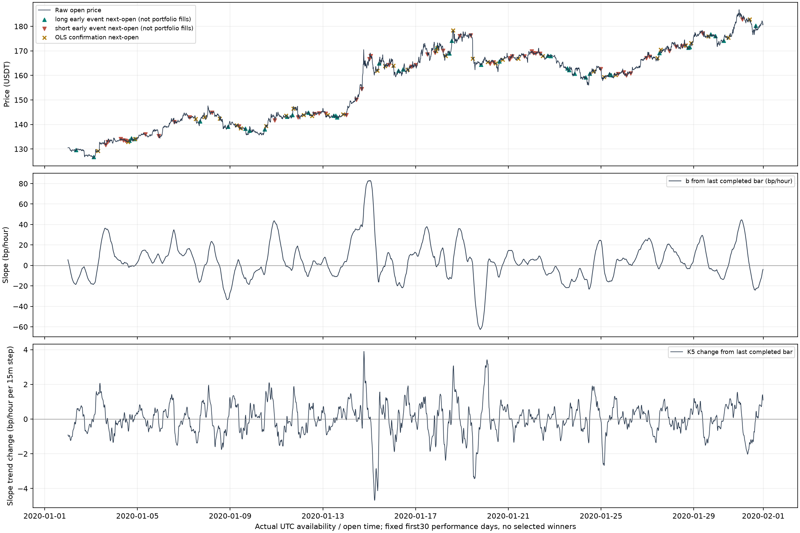
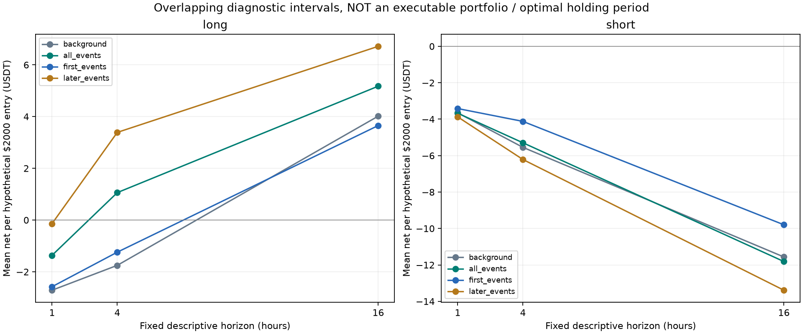
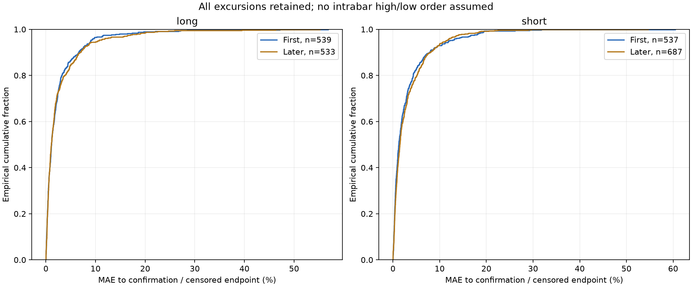

# K=5提前入场诊断：供专家评审

## 核心结论与边界

本轮只诊断提前入场，没有实施完整策略、失败退出、动量退出或tau优化；事件数不是实际交易数。固定15分钟、N=64、K=5、tau=0边界，未选参数。全部2020—2021是已反复研究的开发样本，N64本身也来自既往研究选择，不能称独立未见验证。不计算2022/2023收益，不读2024+。

- long：全部1072次、首次539次；首次事件到可执行过零的中位等待6.75小时，确认前MAE中位1.14%、95分位9.04%、最大56.92%。首次事件1/4/16小时双边成本后平均损益依次为-2.58/-1.24/3.65 USDT（每次假设2000名义，区间重叠，不能累加成账户收益）。
- short：全部1224次、首次537次；首次事件到可执行过零的中位等待8.00小时，确认前MAE中位1.26%、95分位11.99%、最大60.50%。首次事件1/4/16小时双边成本后平均损益依次为-3.42/-4.12/-9.80 USDT（每次假设2000名义，区间重叠，不能累加成账户收益）。

**本轮证据不足以支持直接把原过零入场替换为“每段首次K5上拐就入场”。** 它更早，但首次做多的提前阶段平均价格收益扣费后为负，首次做空平均损失更大；极端浮亏远非可以忽略。固定16小时首次做多虽为正，也没有超过所有负斜率状态的粗略背景均值，不能据此宣称入场择时优势。

具体解释：首次做多到过零的平均净损益2020为-3.53、2021为+1.52 USDT，年度不一致；首次做空分别-16.29/-12.26 USDT。首次做多有58.26%的提前区间净收益为正，但均值-1.05，说明较多小优势并不足以抵消尾部不利路径；首次做空有53.63%为正、均值-14.30，同样不能用超过50%的比例证明优势。相同终点只是把原过零开盘作为早入仓的假设退出，并非原策略的完整持仓回报。

后续做多事件提前阶段均值+5.97，高于首次-1.05，但其出现时点不同、可能一段多个事件、无法事先知道哪次是真反转；这只提示“一次试入可能放弃后续机会”的代价，不能直接改成挑第二次/最后一次或自动放开重复入场。

全部做多1072个机会、首次539个；做空1224个、首次537个。零区间的反复还存在：有事件的负区间49.17%、正区间52.33%包含多次机会，最多分别10/11次。首次机会之中，49.54%做多、52.89%做空在确认前g又反向；K5仍不能消除反复。

这份样本恰好2296个事件均在2021结束前出现可执行确认，所以删失事件表本轮为空；不代表确认必然发生或风险很低，删失分支已用合成测试覆盖。首次做多最长等待71.75小时、做空72.25小时；MAE极值56.92%/60.50%，分别对应约1138.47/1210.03 USDT假设名义损失幅度，未计潜在资金费率和交易所强平，不能将假设持仓路径当可融资执行保证。

原OLS前10赢家前都有首次K5事件，说明机会覆盖10/10，**不等于保留10/10利润或改善10/10入场**；逐笔早入阶段的负收益/MAE仍应审阅。完整原赢家身份和首次事件均保存，不将赢家PnL直接加到新模型。

建议先由专家审阅首次做多的尾部风险与后续机会差异，暂不实施对称早入策略。若继续，只冻结一种明确失败退出，检验它降低尾部的同时会损失多少原赢家；它仍需独立公平对照。不要把本轮16小时观察窗转成最优持仓，不自动改N/K或搜索tau。

必须将“到某个未来时刻终究穿零”与“提前买入确实有优势”区分；长时间接飞刀后最终穿零也算观察到确认，不能称入场成功。首次/后续的完整结果如下，专家应同时看MAE、等待、净价格优势及分年，而非只看确认率。

## 冻结事件公式与时序

beta=原S0最近64根log(close)的OLS；b=40000beta，bp/小时。g=最近5根beta回归斜率，等价[-2,-1,0,1,2]/10的因果中心求和；计算事件用未缩放beta，避免单位变换浮点改变符号。
做多：beta[t]<0且g[t-1]<=0且g[t]>0；做空镜像。双方g有限才发事件，g恰零本身不发事件、不前移标记。事件在t收盘才知道，t+1开盘是最早假设入场。首可执行时点2020-01-02 00:00 UTC，96根暖机；最后不可执行收盘信号不计事件。全周期转向计数包括暖机，避免将已有周期的第二次误说成第一次；边界截断标记cycle_left_truncated。

sign-cycle为连续beta符号区间，beta恰零沿用前符号，零本身不是确认；后续第一次严格相反符号才是该方向的确认。周期切分和未来确认只用于事后描述，事件本身绝不看未来；没有事后挑谷底、峰顶或最赚钱一次。第1次/后续事件按原始时间顺序划分，首次不自动成为策略。

## 全部 / 首次 / 后续事件

| direction | group | events | sign_cycles | confirmation_executable | censored | confirm_within_1h_ratio | confirm_within_4h_ratio | confirm_within_16h_ratio | wait_median_hours | wait_p95_hours | wait_max_hours | mae_median_pct | mae_p95_pct | mae_max_pct | net_to_confirmation_mean | net_to_confirmation_median | positive_net_to_confirmation_ratio | g_reversal_ratio |
|---|---|---|---|---|---|---|---|---|---|---|---|---|---|---|---|---|---|---|
| long | all | 1072 | 539 | 1072 | 0 | 0.075 | 0.291 | 0.816 | 6.750 | 27.250 | 71.750 | 1.119 | 9.392 | 56.924 | 2.438 | 7.018 | 0.615 | 0.500 |
| long | first | 539 | 539 | 539 | 0 | 0.102 | 0.302 | 0.807 | 6.750 | 28.025 | 71.750 | 1.143 | 9.043 | 56.924 | -1.051 | 4.715 | 0.583 | 0.495 |
| long | later | 533 | 265 | 533 | 0 | 0.047 | 0.280 | 0.826 | 6.750 | 26.750 | 55.750 | 1.104 | 10.539 | 55.262 | 5.966 | 9.281 | 0.647 | 0.505 |
| short | all | 1224 | 537 | 1224 | 0 | 0.057 | 0.225 | 0.721 | 8.625 | 37.750 | 72.250 | 1.401 | 11.832 | 60.501 | -10.178 | 2.760 | 0.553 | 0.565 |
| short | first | 537 | 537 | 537 | 0 | 0.073 | 0.257 | 0.724 | 8.000 | 38.900 | 72.250 | 1.262 | 11.993 | 60.501 | -14.297 | 1.145 | 0.536 | 0.529 |
| short | later | 687 | 281 | 687 | 0 | 0.045 | 0.199 | 0.719 | 9.250 | 36.275 | 69.750 | 1.488 | 11.352 | 54.702 | -6.958 | 4.030 | 0.566 | 0.592 |

来源event_summary.csv。确认率期限的分母包含右删失事件，按未观察到期限内确认计；这不是Kaplan-Meier生存估计，尾部可观察时长不同，不能作无偏概率推断。可执行确认才进入等待/确认端点收益统计，右删失保留在单独表和MAE中，禁止删除后声称全部成功。

| direction | cycles | cycles_with_events | cycles_without_event | cycles_with_repeated_events | first_events | later_events | median_events_per_active_cycle | max_events_per_cycle | median_within_cycle_event_gap_hours |
|---|---|---|---|---|---|---|---|---|---|
| long | 574 | 539 | 35 | 265 | 539 | 533 | 1.000 | 10 | 4.000 |
| short | 574 | 537 | 37 | 281 | 537 | 687 | 2.000 | 11 | 4.750 |

来源cycles.csv/cycle_summary.csv。未出现K5转向的周期也保留。高事件数说明同一趋势内存在多次改善，不是本次模拟了对应数量实际交易。多事件常对应同一个过零点，观测强相关。

## 按入场年份检查

| direction | period | events | censored | wait_median_hours | mae_median_pct | mae_p95_pct | mae_max_pct | net_to_confirmation_mean | positive_net_to_confirmation_ratio |
|---|---|---|---|---|---|---|---|---|---|
| long | 2020 | 274 | 0 | 6.500 | 0.977 | 7.642 | 56.924 | -3.535 | 0.536 |
| long | 2021 | 265 | 0 | 7.250 | 1.397 | 9.824 | 47.177 | 1.516 | 0.630 |
| short | 2020 | 272 | 0 | 8.000 | 1.100 | 10.046 | 31.813 | -16.286 | 0.482 |
| short | 2021 | 265 | 0 | 7.750 | 1.417 | 12.150 | 60.501 | -12.256 | 0.592 |

事件按入场年分组；2020入场到2021确认仍保留，不年度强平；样本结束仍未确认按末根close标记，不读2022。这里没有账户年度净收益，只有事件级描述。

## 固定未来1/4/16小时的净价格检验

| direction | group | horizon_hours | observations | available | unavailable | mean_net_usdt | median_net_usdt | net_positive_ratio | mean_raw_signed_bps |
|---|---|---|---|---|---|---|---|---|---|
| long | all_events | 1.000 | 1072 | 1072 | 0 | -1.362 | -2.673 | 0.426 | 7.191 |
| long | first_events | 1.000 | 539 | 539 | 0 | -2.575 | -3.289 | 0.397 | 1.123 |
| long | later_events | 1.000 | 533 | 533 | 0 | -0.136 | -1.846 | 0.456 | 13.328 |
| long | all_events | 4.000 | 1072 | 1072 | 0 | 1.062 | -0.169 | 0.496 | 19.323 |
| long | first_events | 4.000 | 539 | 539 | 0 | -1.240 | -1.808 | 0.471 | 7.804 |
| long | later_events | 4.000 | 533 | 533 | 0 | 3.389 | 0.708 | 0.522 | 30.972 |
| long | all_events | 16.000 | 1072 | 1071 | 1 | 5.175 | 6.141 | 0.550 | 39.910 |
| long | first_events | 16.000 | 539 | 539 | 0 | 3.655 | 6.432 | 0.545 | 32.299 |
| long | later_events | 16.000 | 533 | 532 | 1 | 6.716 | 5.654 | 0.555 | 47.621 |
| short | all_events | 1.000 | 1224 | 1224 | 0 | -3.673 | -3.685 | 0.356 | -4.357 |
| short | first_events | 1.000 | 537 | 537 | 0 | -3.416 | -3.624 | 0.365 | -3.073 |
| short | later_events | 1.000 | 687 | 687 | 0 | -3.874 | -3.748 | 0.349 | -5.360 |
| short | all_events | 4.000 | 1224 | 1224 | 0 | -5.295 | -4.226 | 0.423 | -12.463 |
| short | first_events | 4.000 | 537 | 537 | 0 | -4.121 | -3.898 | 0.449 | -6.598 |
| short | later_events | 4.000 | 687 | 687 | 0 | -6.213 | -4.318 | 0.403 | -17.049 |
| short | all_events | 16.000 | 1224 | 1223 | 1 | -11.814 | -9.204 | 0.430 | -45.028 |
| short | first_events | 16.000 | 537 | 536 | 1 | -9.796 | -9.594 | 0.433 | -34.947 |
| short | later_events | 16.000 | 687 | 687 | 0 | -13.389 | -8.933 | 0.428 | -52.892 |

来源fixed_horizon_summary.csv；固定4/16/64根未来bar，均从下一开盘入场到entry+horizon开盘退出，含双边手续费/滑点。尾部不能退出的保留unavailable，不补2022数据。background为所有相同beta符号、g前后可计算bar，包含事件自身；仅粗略描述背景，不是匹配独立对照组，没有因果识别、置信区间或显著性声称。全部、首次、后续的时点分布不同，也不能直接归因一次试入规则优劣。持有期只是观察窗口，不自动转成最优退出或搜索维度。完整可用/不可用明细全部保存。

## 费用、MAE/MFE和删失定义

固定名义2000、entry_fill=open*(1+s*0.0002)、q=2000/entry_fill；单边手续费0.0005，退出也按不利方向滑点。gross、fee、slippage、net逐事件对账。价格优势raw_signed_bps=s*(confirmation_open/entry_open-1)*10000为无成本端点方向收益；net_to_confirmation在原过零可入场开盘假设退出早入仓，不是原策略完整交易收益。

MAE/MFE以实际假设滑点入场价为基准，并计入数量对应USDT；含入场K线至退出前一K线高低，退出根只纳入开盘价，不含其后高低。右删失包含最后根高低并按末close MTM，仅收取已发生的入场费及滑点、不造平仓费；其最终损益和MAE都是截至观察终点，不是假设永久持仓结果。MAE/MFE下限0；OHLCV无法恢复盘中高低先后。比较窗口到过零的MAE与长期持仓MAE不同，不能将它直接推导为止损阈值。

## 原S0前10大赢家的提前机会

| original_winner_rank | direction | original_net_usdt | eligible_events | first_event_exists | first_event_id |
|---|---|---|---|---|---|
| 1 | long | 736.594 | 5 | True | 1158 |
| 2 | short | 720.290 | 2 | True | 220 |
| 3 | short | 446.221 | 2 | True | 1577 |
| 4 | long | 414.001 | 1 | True | 1262 |
| 5 | short | 391.950 | 2 | True | 1315 |
| 6 | short | 369.774 | 4 | True | 1188 |
| 7 | long | 366.148 | 1 | True | 670 |
| 8 | long | 347.723 | 1 | True | 107 |
| 9 | long | 342.761 | 1 | True | 303 |
| 10 | long | 332.541 | 1 | True | 1523 |

| original_winner_rank | event_id | direction | wait_hours | mae_pct | net_usdt | raw_signed_bps |
|---|---|---|---|---|---|---|
| 1 | 1158 | long | 19.500 | 3.325 | -7.369 | -22.866 |
| 2 | 220 | short | 1.750 | 0.577 | 4.328 | 35.612 |
| 3 | 1577 | short | 6.750 | 2.869 | 67.986 | 353.613 |
| 4 | 1262 | long | 1.000 | 0.187 | 7.345 | 50.770 |
| 5 | 1315 | short | 8.250 | 0.753 | 32.414 | 175.914 |
| 6 | 1188 | short | 26.750 | 10.523 | -123.290 | -601.904 |
| 7 | 670 | long | 7.750 | 1.091 | -12.875 | -50.421 |
| 8 | 107 | long | 3.750 | 0.159 | 0.929 | 18.657 |
| 9 | 303 | long | 0.250 | 0.152 | 4.272 | 35.390 |
| 10 | 1523 | long | 6.750 | 0.804 | 1.961 | 23.823 |

来源original_top10_mapping.csv和original_top10_preentry_events.csv。固定原OLS N64已平仓净收益前10身份；仅检查它们入场前的相反符号周期中有哪些合格事件。不能选择其中价格最好的一次，不能把原赢家PnL认领为提前入场贡献；本轮没有定义新的完整持仓退出，所以不计算所谓保留率或修改后的top10利润。是否有首次事件只是机会覆盖，不是获利保证。专家可查看每个前置事件的等待、MAE和提前阶段损益。

## 不能省略的最不利路径

| event_id | direction | entry_time | ordinal_in_cycle | wait_hours | mae_pct | mae_usdt | net_usdt |
|---|---|---|---|---|---|---|---|
| 1163 | short | 2021-01-02 10:30:00+00:00 | 1 | 54.500 | 60.501 | 1210.025 | -763.909 |
| 222 | long | 2020-03-11 13:30:00+00:00 | 1 | 45.750 | 56.924 | 1138.474 | -721.563 |
| 223 | long | 2020-03-11 20:15:00+00:00 | 2 | 39.000 | 55.262 | 1105.246 | -672.217 |
| 1164 | short | 2021-01-02 21:00:00+00:00 | 2 | 44.000 | 54.702 | 1094.035 | -664.075 |
| 1579 | long | 2021-05-18 21:00:00+00:00 | 1 | 36.500 | 47.177 | 943.539 | -488.266 |
| 1580 | long | 2021-05-19 00:00:00+00:00 | 2 | 33.500 | 46.298 | 925.952 | -463.083 |
| 224 | long | 2020-03-12 16:00:00+00:00 | 3 | 19.250 | 39.503 | 790.066 | -204.149 |
| 247 | short | 2020-03-19 02:30:00+00:00 | 1 | 41.000 | 31.813 | 636.250 | -297.719 |
| 1165 | short | 2021-01-03 19:30:00+00:00 | 3 | 21.500 | 29.669 | 593.388 | -233.162 |
| 1596 | short | 2021-05-24 05:30:00+00:00 | 1 | 28.750 | 29.281 | 585.623 | -324.428 |

来源extreme_mae_events.csv，只用于暴露尾部，不用于选择参数；完整事件始终保留。到确认的观察窗口长短不同，MAE是条件于该窗口的风险，不能与固定持有期无条件比较。

## 图形与交互复核

打开 [event_explorer.html](event_explorer.html)：价格、b、g按真实UTC可用时间对齐；所有提前事件与确认点可见，可筛选方向/年份/首次后续/删失，点击事件查看完整区间，不会只展示成功例子。K线价格为raw open；在同一open坐标绘制上一根已收盘的b/g，避免将收盘信号提前15分钟。详细提示有原OHLC和时间标记。密集图使用像素组最小最大包络而非平滑，放大恢复逐点；全部原始数据内嵌可离线打开。

## 专家评审建议与停止点

首先判断首次做多事件是否在两年都体现足够价格优势，代价是否为较大MAE/等待，以及后续事件是否仅更靠近未来确认；后续更好不意味着可以实时选择“最后一次”。做空单独判断，不因对称数学而假设对称优势。若优势只在较长窗口出现，也可能来自ETH这两年的价格漂移和条件选择，不能立即构建策略。
事件反复、风险暴露、方向与年份不同，需要在选择失败退出前先审阅。若本轮出现正向均值，下一轮只应固定入场后检验一种失败退出与原基准，不能同时优化入场/退出/tau。若没有稳定优势，保留原过零入场，不强迫增加复杂性。
本轮不自动冻结新模型、不开参数搜索、不做完整新策略回测。审阅后再决定是否继续。

## 复现和原结果保护

数据hash `23972d31dd5ff90b46da05703e1b75dbfbbbbfde6efcd26b6b9ad24ee3b65503`，原loader仅读六列OHLCV，原2020—2023快照结构QC后去掉2022/2023再计算，无2024+。原S0控制账本、成本、多空、权益门禁通过，唯一组合模拟是原基准复现。本轮没有计算新策略Sharpe/PF/总净利润，以免将事件相加伪装为可执行回测。

仓库根目录：设置`.deps`到PYTHONPATH，运行`python -m pytest -q`、`python experiments/k5_entry_diagnostic/run_analysis.py`、`python tools/verify_k5_entry.py`。配置config/k5_entry_diagnostic.json在结果计算前固定；metadata.json记录数据/代码/配置hash，manifest覆盖本目录除自身外全部交付。原S0/S1.3/观察页不修改。旧K1探索属于先前误扩展解释，不能当作本轮K5结果。
