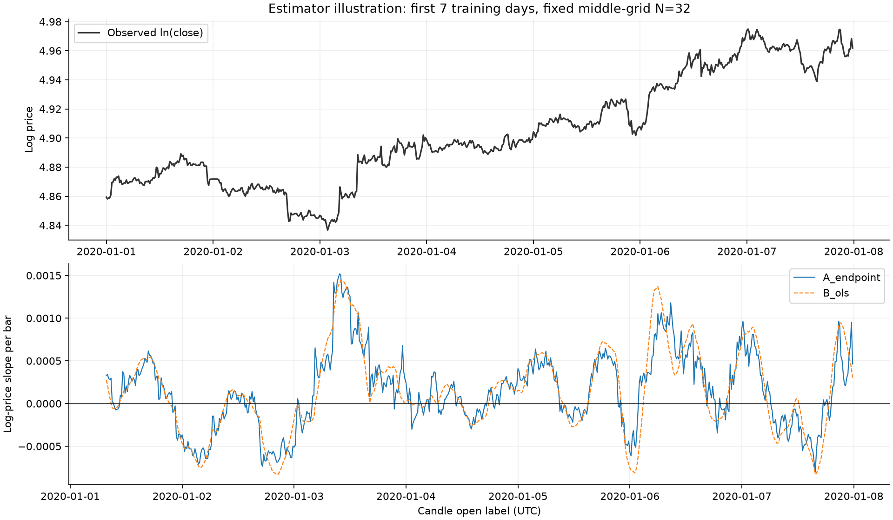
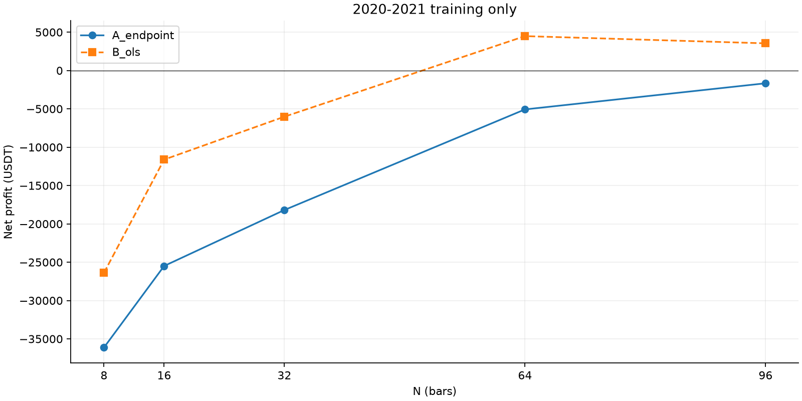
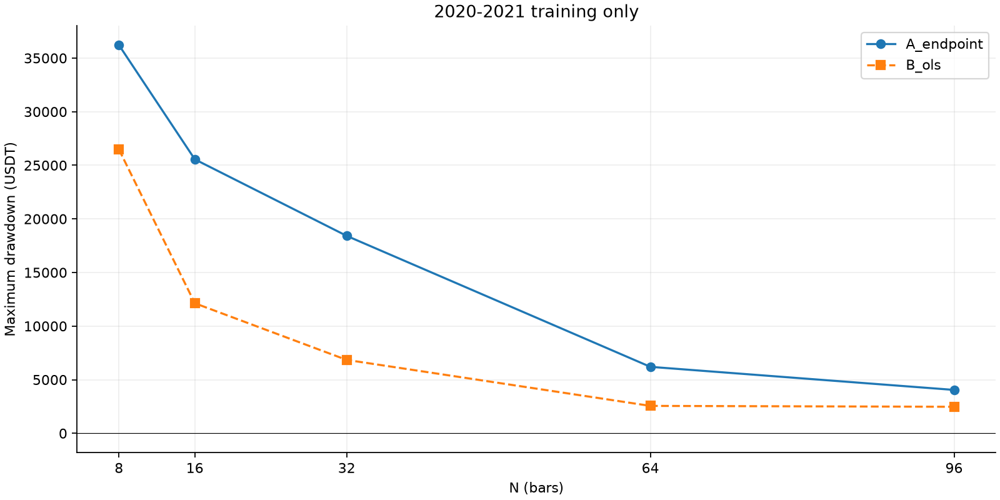
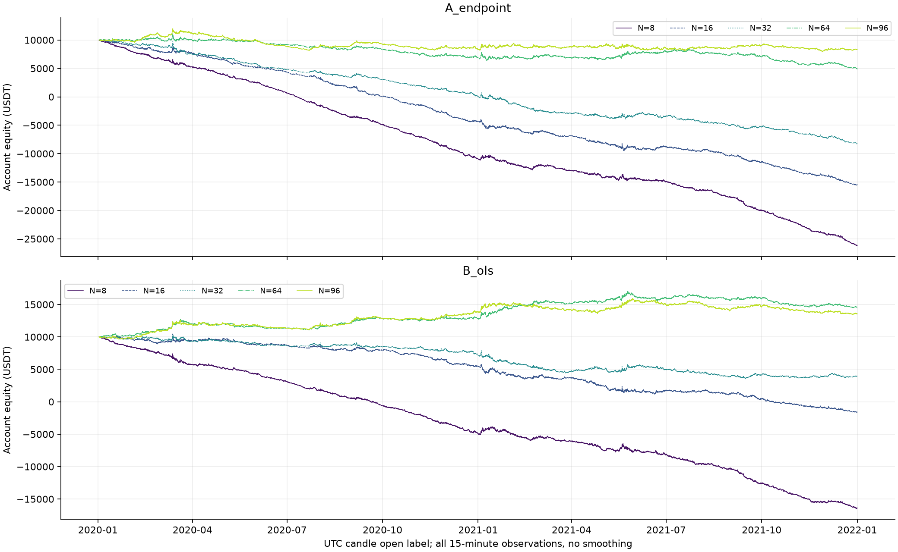
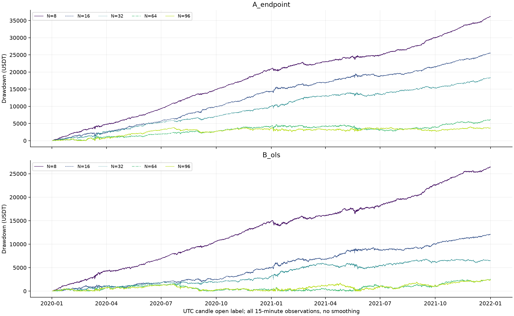
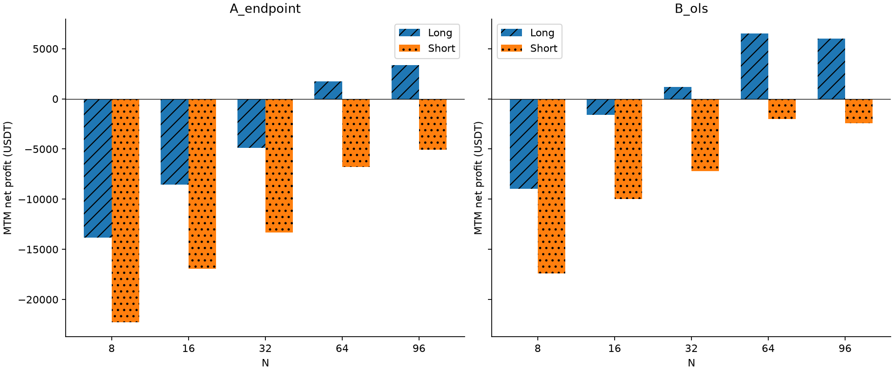
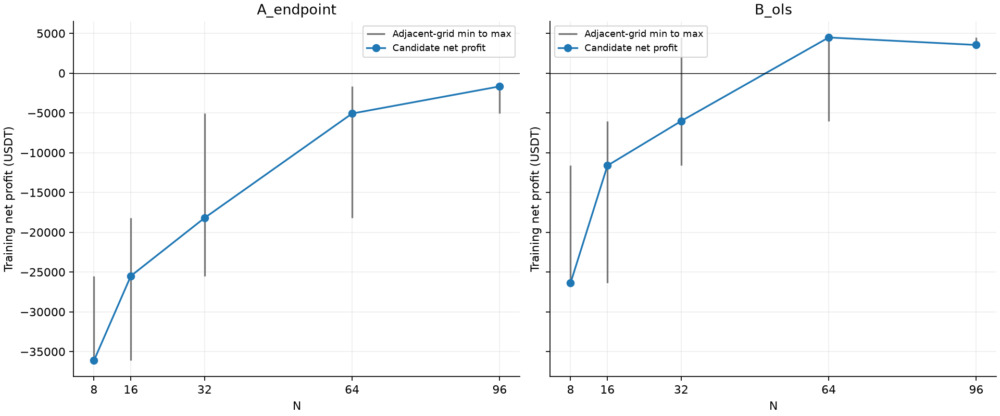

# S0 从零斜率估计研究：2020—2021训练结果

任务：`S0_FROM_SCRATCH_SLOPE_ESTIMATOR_2020_2023`。

## 范围与结论边界

只比较端点A与滚动OLSB，每种固定N=[8,16,32,64,96]，共10组。方法选择本身也是模型选择自由度。
本轮没有自动排名、最佳模型或候选冻结；没有计算2022/2023绩效，亦未读取2024+行情。
四年行情曾参与旧策略研究，本轮任何时段均不能称为完全未见的独立样本外。以下是训练证据，不能证明未来交易价值。

**资金可执行性限制：5/10组曾出现保证金预算不足或非正权益。它们的全期结果是固定名义信号账本的假设延续，不是初始10000 USDT能够持续执行的账户回测。资金不足后仍按同一规则记账，没有追加保证金、自动缩仓或引入退出条件。**

| candidate | min_actual_equity | first_margin_shortfall_time | first_nonpositive_equity_time | margin_budget_shortfall_entries | funded_execution_feasible |
|---|---|---|---|---|---|
| A_endpoint_N8 | -26202.416 | 2020-06-26 13:45:00+00:00 | 2020-07-10 11:30:00+00:00 | 9842 | False |
| A_endpoint_N16 | -15532.541 | 2020-09-08 08:45:00+00:00 | 2020-10-03 16:30:00+00:00 | 5755 | False |
| A_endpoint_N32 | -8282.654 | 2020-12-03 08:15:00+00:00 | 2021-01-01 06:30:00+00:00 | 3295 | False |
| A_endpoint_N64 | 4913.879 | nan | nan | 0 | True |
| A_endpoint_N96 | 7972.656 | nan | nan | 0 | True |
| B_ols_N8 | -16462.627 | 2020-08-19 02:15:00+00:00 | 2020-09-19 15:00:00+00:00 | 6381 | False |
| B_ols_N16 | -1658.483 | 2021-09-12 08:30:00+00:00 | 2021-10-10 21:30:00+00:00 | 725 | False |
| B_ols_N32 | 3583.419 | nan | nan | 0 | True |
| B_ols_N64 | 9998.600 | nan | nan | 0 | True |
| B_ols_N96 | 9652.573 | nan | nan | 0 | True |

- A_endpoint：五个N净利润范围 -36124.97 至 -1663.84 USDT；盈利 0/5；两年均盈利的N为 []。最大回撤范围 4045.98—36216.88 USDT。平均持仓 1.34—5.45 小时。
- B_ols：五个N净利润范围 -26378.18 至 4487.47 USDT；盈利 2/5；两年均盈利的N为 [64]。最大回撤范围 2472.79—26477.09 USDT。平均持仓 1.85—23.33 小时。

不能据累计净利润峰值直接选择N。参数邻域是固定离散网格上的描述性比较，端点只有两个邻域点，不能向网格外推断。完整10组、年度差异、费用及交易集中度如下，交由负责人判断哪些结构值得冻结验证。

## 本轮六个研究问题的回答

1. **方法稳定性**：端点法在整个既定网格均亏损；OLS只在较大窗口有正收益，不能据此称OLS在整个参数域都稳定。五个N的分布比单个峰值更有意义。
2. **N变化是否平滑**：端点法随N增加，亏损整体减少；OLS从N32到N64出现较大的收益跳变，之后N96累计仍为正。N间距不均，不能把连线当作连续响应证据。
3. **年度差异**：OLS N64两年分别为正，N96主要来自2020而2021转负；长窗口的累计邻近盈利未转化为一致年度稳健性。端点N96的2021微利也不能抵消其2020亏损。
4. **孤立点与稳定区**：OLS N64、96在累计净收益上是相邻的两个正值，但N64的另一侧N32亏损，N96又是网格端点，且二者年度结果不同。因此暂不能认定存在已确认的连续稳定近优区域，不增加N48/80或其他新候选检验。
5. **多空平衡**：所有10组空头净收益都为负；两个累计盈利OLS候选均依赖多头贡献，不能称多空均合理。不能通过关闭空头或给多空独立N改善本轮结果。
6. **成本与极端交易**：多组账面毛收益为正、扣实际费用滑点后转负，频繁翻向的摩擦是明确问题，但部分端点候选连毛收益也为负，不能全归因于成本。OLS N64描述性扣除最盈利10笔后仅约19.47 USDT，N96则约−1219.16 USDT；正收益对少数大赢家有实质依赖。这不证明趋势模型无效，也不足以宣告可以交易，需负责人审阅后再决定是否接受后续冻结检验。

## 数据与预登记口径

只读取date/open/high/low/close/volume六列，数据SHA256 `23972d31dd5ff90b46da05703e1b75dbfbbbbfde6efcd26b6b9ad24ee3b65503`，不一致立即停止。
原始快照140256根，仅用于结构核验；送入指标、信号、执行及统计的是2020—2021的70176根。
首96根只预热，统一从2020-01-02 00:00 UTC开盘开始成交，共70080根绩效K线，年界不平仓、不重置指标。
零成交量不删除、不补价：原快照97根，训练输入39根；全候选共 44 项假设成交发生于零成交量K线（反向平仓及开仓各一项，跨候选不去重）。详见zero_volume_execution_audit.csv，无法由OHLCV证明可成交。
N表示观测点数量，N根K线覆盖N×15分钟，首尾收盘点间隔(N−1)×15分钟。A和B单位均为每根K线的对数价格变化，无乘100、标准化或阈值。
初始账户10000，固定2000成交名义（1000保证金、2倍），不复利；费用另扣。单边手续费0.05%、滑点0.02%，买入向上、卖出向下，反向旧仓退出与新仓进入分别扣费。
无资金费率、交易所强平、盘口深度或延迟模型。固定名义账本遇到保证金预算不足时记录而不更改信号/仓位，不能作为可实际融资的交易结果；本次不足事件数 25998。

## 全部10组训练指标

PF、胜率及持仓时间仅包含实际平仓；净利润含末期未平仓MTM。win_rate和monthly_profit_ratio为0—1比例。

| candidate | long_net_profit | short_net_profit | net_profit | max_drawdown_usdt | profit_factor | sharpe | sortino | win_rate | trade_count | average_holding_hours | monthly_profit_ratio |
|---|---|---|---|---|---|---|---|---|---|---|---|
| A_endpoint_N8 | -13837.362 | -22287.610 | -36124.972 | 36216.877 | 0.670 | -10.369 | -10.178 | 0.248 | 13077 | 1.340 | 0.000 |
| A_endpoint_N16 | -8540.159 | -16951.813 | -25491.972 | 25554.134 | 0.696 | -6.365 | -7.206 | 0.237 | 9031 | 1.940 | 0.042 |
| A_endpoint_N32 | -4880.716 | -13310.523 | -18191.239 | 18416.512 | 0.718 | -4.228 | -5.227 | 0.233 | 6322 | 2.770 | 0.042 |
| A_endpoint_N64 | 1727.345 | -6798.290 | -5070.945 | 6198.735 | 0.884 | -1.148 | -1.651 | 0.239 | 4155 | 4.215 | 0.250 |
| A_endpoint_N96 | 3387.844 | -5051.686 | -1663.841 | 4045.980 | 0.952 | -0.396 | -0.599 | 0.247 | 3215 | 5.449 | 0.458 |
| B_ols_N8 | -8953.483 | -17424.702 | -26378.185 | 26477.088 | 0.722 | -7.685 | -8.404 | 0.279 | 9476 | 1.849 | 0.083 |
| B_ols_N16 | -1611.302 | -10006.762 | -11618.063 | 12130.144 | 0.815 | -2.935 | -3.839 | 0.298 | 4741 | 3.695 | 0.125 |
| B_ols_N32 | 1201.927 | -7222.599 | -6020.672 | 6845.724 | 0.862 | -1.518 | -2.060 | 0.311 | 2380 | 7.358 | 0.250 |
| B_ols_N64 | 6515.405 | -2027.935 | 4487.470 | 2555.870 | 1.172 | 1.077 | 1.748 | 0.347 | 1147 | 15.271 | 0.625 |
| B_ols_N96 | 5995.452 | -2449.328 | 3546.123 | 2472.793 | 1.169 | 0.876 | 1.442 | 0.341 | 751 | 23.326 | 0.500 |

## 年度对比（保持跨年仓位）

| candidate | period | net_profit | long_net_profit | short_net_profit | max_drawdown_usdt | profit_factor | fees | slippage_usdt |
|---|---|---|---|---|---|---|---|---|
| A_endpoint_N8 | 2020 | -20933.898 | -8394.646 | -12539.252 | 20948.359 | 0.589 | 13631.069 | 5452.428 |
| A_endpoint_N8 | 2021 | -15191.074 | -5442.715 | -9748.358 | 15984.151 | 0.741 | 12528.148 | 5011.259 |
| A_endpoint_N16 | 2020 | -14274.438 | -5051.232 | -9223.206 | 14450.887 | 0.631 | 9523.083 | 3809.233 |
| A_endpoint_N16 | 2021 | -11217.534 | -3488.927 | -7728.607 | 11580.366 | 0.752 | 8544.124 | 3417.649 |
| A_endpoint_N32 | 2020 | -9921.496 | -2874.940 | -7046.557 | 10055.354 | 0.661 | 6527.083 | 2610.833 |
| A_endpoint_N32 | 2021 | -8269.743 | -2005.777 | -6263.966 | 9122.088 | 0.765 | 6122.158 | 2448.863 |
| A_endpoint_N64 | 2020 | -3060.746 | 593.015 | -3653.761 | 4244.965 | 0.848 | 4441.129 | 1776.452 |
| A_endpoint_N64 | 2021 | -2010.199 | 1134.330 | -3144.529 | 3420.742 | 0.915 | 3874.143 | 1549.657 |
| A_endpoint_N96 | 2020 | -1685.776 | 1306.088 | -2991.864 | 3849.165 | 0.896 | 3457.152 | 1382.861 |
| A_endpoint_N96 | 2021 | 21.935 | 2081.757 | -2059.821 | 1474.789 | 1.001 | 2978.070 | 1191.228 |
| B_ols_N8 | 2020 | -14952.188 | -5410.191 | -9541.997 | 14966.649 | 0.650 | 9711.063 | 3884.425 |
| B_ols_N8 | 2021 | -11425.996 | -3543.291 | -7882.705 | 12615.214 | 0.782 | 9246.172 | 3698.469 |
| B_ols_N16 | 2020 | -4510.204 | -182.338 | -4327.866 | 5100.459 | 0.831 | 4827.071 | 1930.829 |
| B_ols_N16 | 2021 | -7107.859 | -1428.963 | -5678.896 | 7418.903 | 0.803 | 4660.129 | 1864.051 |
| B_ols_N32 | 2020 | -2811.589 | 676.581 | -3488.170 | 3241.841 | 0.852 | 2437.086 | 974.834 |
| B_ols_N32 | 2021 | -3209.083 | 525.346 | -3734.429 | 4384.099 | 0.870 | 2328.154 | 931.262 |
| B_ols_N64 | 2020 | 2864.129 | 3549.788 | -685.659 | 1593.434 | 1.266 | 1177.132 | 470.853 |
| B_ols_N64 | 2021 | 1623.341 | 2965.617 | -1342.276 | 2555.870 | 1.107 | 1122.136 | 448.854 |
| B_ols_N96 | 2020 | 3832.027 | 4046.269 | -214.243 | 1482.724 | 1.479 | 769.125 | 307.650 |
| B_ols_N96 | 2021 | -285.903 | 1949.182 | -2235.086 | 2472.793 | 0.978 | 738.094 | 295.238 |

年度净收益按该年度K线的MTM增量归属，最后一根K线的收盘按其开盘标签所属年度归属；不代表年界强制退出。
PF/胜率将整笔已平仓交易归到退出年度，与年度MTM不是同一会计口径。

## 方法层面的网格稳健性

| method | candidates | profitable_candidates | both_years_positive_candidates | net_min | net_median | net_max | worst_drawdown | median_profit_factor | median_sharpe | median_monthly_profit_ratio | median_closed_trades |
|---|---|---|---|---|---|---|---|---|---|---|---|
| A_endpoint | 5 | 0 | 0 | -36124.972 | -18191.239 | -1663.841 | 36216.877 | 0.718 | -4.228 | 0.042 | 6322 |
| B_ols | 5 | 2 | 1 | -26378.185 | -6020.672 | 4487.470 | 26477.088 | 0.862 | -1.518 | 0.250 | 2380 |

这些是五个既定N的等权描述性汇总，不是可交易组合，也不是自动方法选择评分。

## 参数邻域与年度一致性

| candidate | neighbor_N | neighborhood_net_min | neighborhood_net_max | neighborhood_profitable_fraction | both_training_years_positive | strict_interior_local_net_peak | endpoint_caution |
|---|---|---|---|---|---|---|---|
| A_endpoint_N8 | 8,16 | -36124.972 | -25491.972 | 0.000 | False | False | True |
| A_endpoint_N16 | 8,16,32 | -36124.972 | -18191.239 | 0.000 | False | False | False |
| A_endpoint_N32 | 16,32,64 | -25491.972 | -5070.945 | 0.000 | False | False | False |
| A_endpoint_N64 | 32,64,96 | -18191.239 | -1663.841 | 0.000 | False | False | False |
| A_endpoint_N96 | 64,96 | -5070.945 | -1663.841 | 0.000 | False | False | True |
| B_ols_N8 | 8,16 | -26378.185 | -11618.063 | 0.000 | False | False | True |
| B_ols_N16 | 8,16,32 | -26378.185 | -6020.672 | 0.000 | False | False | False |
| B_ols_N32 | 16,32,64 | -11618.063 | 4487.470 | 0.333 | False | False | False |
| B_ols_N64 | 32,64,96 | -6020.672 | 4487.470 | 0.667 | True | True | False |
| B_ols_N96 | 64,96 | 3546.123 | 4487.470 | 1.000 | False | False | True |

邻域只取同方法中现有相邻网格点（包含自身），并不等于等距离参数扰动。表中strict_interior_local_net_peak仅表示内部离散局部峰值，不自动认定为过拟合，也不将其宣布为最佳。

## 成本与极端盈利交易依赖

| candidate | gross_before_cost | fees | slippage_usdt | top1_share_winning_profit | top5_share_winning_profit | top10_share_winning_profit | net_without_top10_winning_trades |
|---|---|---|---|---|---|---|---|
| A_endpoint_N8 | 497.932 | 26159.217 | 10463.687 | 0.006 | 0.021 | 0.034 | -38628.202 |
| A_endpoint_N16 | -197.882 | 18067.207 | 7226.883 | 0.009 | 0.031 | 0.054 | -28650.642 |
| A_endpoint_N32 | -482.301 | 12649.241 | 5059.697 | 0.010 | 0.046 | 0.079 | -21871.273 |
| A_endpoint_N64 | 6570.436 | 8315.272 | 3326.109 | 0.020 | 0.071 | 0.115 | -9533.773 |
| A_endpoint_N96 | 7345.469 | 6435.221 | 2574.089 | 0.022 | 0.078 | 0.134 | -6063.705 |
| B_ols_N8 | 161.945 | 18957.235 | 7582.894 | 0.006 | 0.023 | 0.037 | -28916.053 |
| B_ols_N16 | 1664.017 | 9487.200 | 3794.880 | 0.010 | 0.033 | 0.056 | -14490.699 |
| B_ols_N32 | 650.664 | 4765.240 | 1906.096 | 0.015 | 0.057 | 0.094 | -9608.559 |
| B_ols_N64 | 7706.444 | 2299.267 | 919.707 | 0.024 | 0.088 | 0.146 | 19.466 |
| B_ols_N96 | 5656.230 | 1507.219 | 602.888 | 0.040 | 0.119 | 0.194 | -1219.163 |

gross_before_cost保持实际固定名义产生的数量，逐笔加回已经发生的费用与滑点，不是另跑无成本策略。
topK_share_winning_profit分母为已平仓正收益交易之和，表示收益集中度；删除topK的净收益只是描述性扣除，不是可执行反事实回测。净收益为负时topK/net比例留空，避免误导。
若费用和滑点超过gross_before_cost，意味着成本足以吞噬该候选的账面毛收益；不能据此改成本假设重新选择更有利结果。
多空贡献保留正负金额；亏损组合不使用“收益占比”掩盖方向失衡。详细direction_comparison.csv保留方向费用、滑点、平仓次数及PF。

## 统计、成交与期末

每个收盘信号仅能在下一根open成交；源K线open标签、signal_available_at及fill_time独立记录，两者可用边界相同不代表使用未来信息。
严格β=0时保持上一信号（初始为0）；无效β不下单，不把它变成中性平仓。OLS不使用近零容差阈值。
最大回撤基于15分钟收盘MTM，含初始账户峰值，同时输出USDT/运行峰值百分比/初始本金百分比。年度回撤只重置统计峰值，不重置仓位。
Sharpe基于每日MTM增量/固定10000，rf=0，样本标准差ddof=1及sqrt(365)年化；Sortino用所有日收益负部RMS作分母。
末期持仓按2021-12-31 23:45标签K线的收盘MTM，不伪造退出、不扣未发生退出费。最终收盘反向信号没有下一根已授权K线，保持未执行；进入后续验证时应在2022首根open执行，须冻结记录携带此状态。

## 核验与下一步

10组独立重复运行逐笔、成交事件及每根权益精确一致；年度/月度/方向/成本/逐笔（含末期MTM）与权益增量对账通过。
模型公式与窗口、前缀、未来扰动、正负零及无效信号、反向双费、下一开盘、不利滑点、跨年、末端与零成交量执行均有测试。
代码不导入或调用任何归档实现，不读取旧特征/模型/执行器/优化结果。
本轮完成后停止；等待负责人审阅10组及邻域证据，确定方法和N并形成冻结记录，然后才可运行2022—2023。验证差不能反过来重新选N。

## 图表（对应CSV为底层数据，完整15分钟曲线，无平滑）

