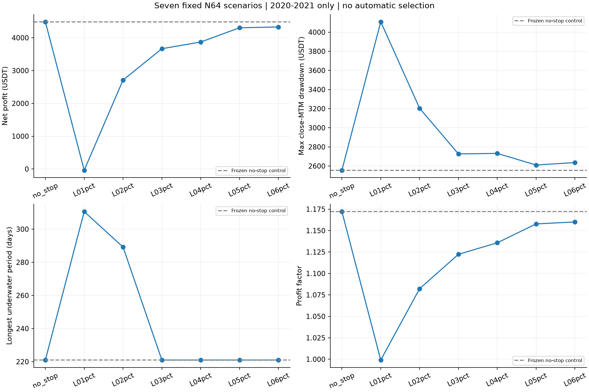
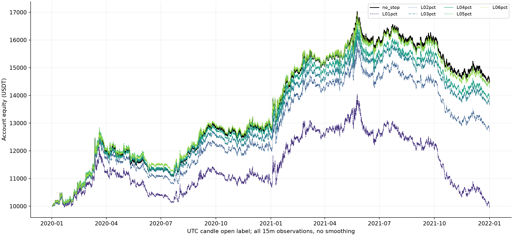
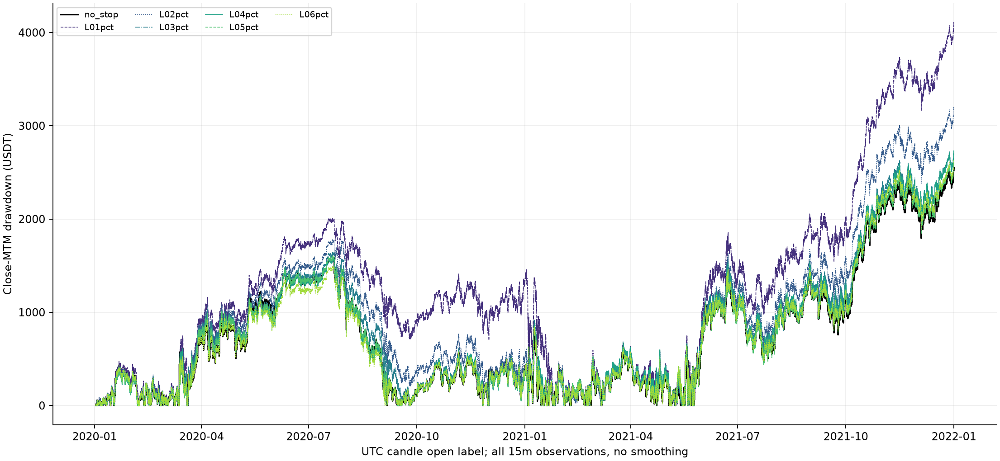
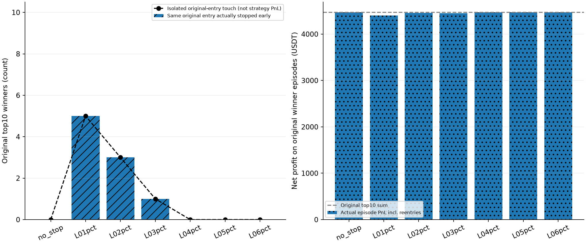
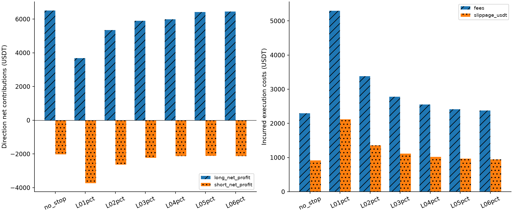
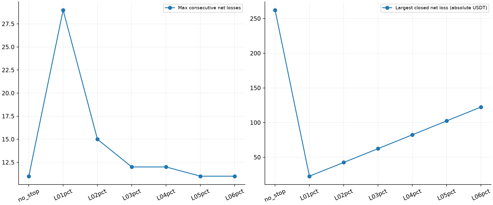

# S1.2 固定价格止损：2020—2021七组结果

## 范围与冻结

S0策略提交fd6658dbde9d046488577062dc53b84ef621c4bf保持字节不变，S1.1提交476be2cb349f85732a498e4bd0a7ddefdd44432b及全部已跟踪文件也不改动。
只研究OLS N64，唯一新增参数L=[1%,2%,3%,4%,5%,6%]，多空共用；另保留无止损对照。N96不重跑、不作为新搜索维度。
严格只计算2020—2021。2022/2023未计算绩效、未用于选L；它们曾用于旧研究，不能称独立未见OOS。未读取2024+。本轮不自动选参数、不冻结候选、不运行第二轮。

## 七组总表（全部展示，不按收益排名）

| scenario | net_profit | max_drawdown_usdt | max_drawdown_pct_peak | longest_underwater_days | max_single_trade_loss | max_consecutive_losses | profit_factor | sharpe | sortino | trade_count | stop_exits | fees | slippage_usdt |
|---|---|---|---|---|---|---|---|---|---|---|---|---|---|
| no_stop | 4487.470 | 2555.870 | 15.008 | 220.969 | -262.314 | 11 | 1.172 | 1.077 | 1.748 | 1147 | 0 | 2299.267 | 919.707 |
| L01pct | -36.717 | 4108.670 | 29.225 | 310.583 | -22.758 | 29 | 0.999 | -0.008 | -0.013 | 2645 | 1600 | 5294.740 | 2117.897 |
| L02pct | 2710.098 | 3204.133 | 20.151 | 289.219 | -42.591 | 15 | 1.082 | 0.639 | 1.006 | 1690 | 603 | 3385.003 | 1354.002 |
| L03pct | 3666.418 | 2726.294 | 16.645 | 220.969 | -62.442 | 12 | 1.122 | 0.873 | 1.397 | 1387 | 274 | 2779.082 | 1111.633 |
| L04pct | 3871.071 | 2731.936 | 16.468 | 220.969 | -82.456 | 12 | 1.136 | 0.924 | 1.485 | 1272 | 139 | 2549.062 | 1019.625 |
| L05pct | 4304.625 | 2610.136 | 15.443 | 220.969 | -102.470 | 11 | 1.158 | 1.033 | 1.673 | 1205 | 64 | 2415.251 | 966.101 |
| L06pct | 4329.170 | 2636.280 | 15.551 | 220.969 | -122.484 | 11 | 1.160 | 1.037 | 1.677 | 1184 | 44 | 2373.282 | 949.313 |

- L01pct：净收益-36.72 USDT（相对对照-4524.19），最大收盘回撤4108.67（+60.8%），最长水下310.58天；原始top10同入口提前止损5/10，经历重入后的原赢家区间净收益4399.34 USDT。
- L02pct：净收益2710.10 USDT（相对对照-1777.37），最大收盘回撤3204.13（+25.4%），最长水下289.22天；原始top10同入口提前止损3/10，经历重入后的原赢家区间净收益4457.90 USDT。
- L03pct：净收益3666.42 USDT（相对对照-821.05），最大收盘回撤2726.29（+6.7%），最长水下220.97天；原始top10同入口提前止损1/10，经历重入后的原赢家区间净收益4449.26 USDT。
- L04pct：净收益3871.07 USDT（相对对照-616.40），最大收盘回撤2731.94（+6.9%），最长水下220.97天；原始top10同入口提前止损0/10，经历重入后的原赢家区间净收益4468.00 USDT。
- L05pct：净收益4304.62 USDT（相对对照-182.85），最大收盘回撤2610.14（+2.1%），最长水下220.97天；原始top10同入口提前止损0/10，经历重入后的原赢家区间净收益4468.00 USDT。
- L06pct：净收益4329.17 USDT（相对对照-158.30），最大收盘回撤2636.28（+3.1%），最长水下220.97天；原始top10同入口提前止损0/10，经历重入后的原赢家区间净收益4468.00 USDT。

## 四个研究问题

本轮最明确的共同结果是：**六个L的最大单笔亏损都减少，但净利润、PF、Sharpe全部低于无止损对照，最大收盘回撤全部高于对照，最长水下期没有任何一组缩短。** 这不满足“风险曲线明显改善且利润不过度牺牲”的初衷，不能因单笔亏损变小就宣布策略质量提高。
1%—2%邻域均呈更高回撤、更长水下和更低PF；4%—6%的原top10保持完整，但整体指标仍未超过对照，邻近表现接近原策略不等于有新增收益。
因此，这组训练证据暂不支持为整体质量改善而采用所测固定止损。保留原无止损作为审阅对照，不自动将任何L写入策略配置；是否继续及如何解释风险预算由负责人决定，不能为改善结果扩大网格。

### 1. 是否减少大亏损

最大单笔亏损和最大回撤见总表；价格L不是账户或杠杆后亏损。2000名义、1000保证金下，止损价处退出的毛损失约2000×L，保证金亏损约2L，再计滑点及双边费。
跳空按更差open成交，固定L不是最大实际损失保证。盘中触发再计退出不利滑点，因此最大净亏损也可超过2000×L。stop_gap_audit.csv保留每项跳空。
回撤为15分钟close MTM，含初始10000峰值，不是交易所强平或完整盘中回撤；止损不能据此证明交易所强平风险已解决。

### 2. 是否误杀原始大赢家（重点top10）

| scenario | original_top10_entry_early_stop_count | original_top10_same_entry_skipped_count | original_top10_held_intact_count | original_top10_isolated_touch_count | original_top10_episode_net_profit | original_top10_episode_profit_retention | original_top10_episodes_still_positive |
|---|---|---|---|---|---|---|---|
| no_stop | 0 | 0 | 10 | 0 | 4468.004 | 1.000 | 10 |
| L01pct | 5 | 0 | 5 | 5 | 4399.341 | 0.985 | 10 |
| L02pct | 3 | 0 | 7 | 3 | 4457.897 | 0.998 | 10 |
| L03pct | 1 | 0 | 9 | 1 | 4449.259 | 0.996 | 10 |
| L04pct | 0 | 0 | 10 | 0 | 4468.004 | 1.000 | 10 |
| L05pct | 0 | 0 | 10 | 0 | 4468.004 | 1.000 | 10 |
| L06pct | 0 | 0 | 10 | 0 | 4468.004 | 1.000 | 10 |

原始top10固定为S0 N64已平仓净收益最高10笔，原总净收益4468.00 USDT；不是各L重新选出10笔。
“同入口提前止损”必须实际模拟中在原入场时刻开仓且在原退出之前被止损；“完整保留”是同入口持有至原反向退出；若之前gap-stop使原入口被跳过，会单列，不冒充提前止损。
“独立原入口触及”仅用原交易入场fill与原路径做固定止损是否触及的审计，排除原退出K线后续极值。它不含策略止损后的重入，不当作真实候选净收益。
原赢家区间收益是候选在该原始同向区间内所有实际开仓（含多次重入）的净收益，不能只数首次提前退出就认定整段利润永久丢失。all_original_episode_audit.csv覆盖所有原始已平仓区间；original_top10_winner_audit.csv逐笔列出10笔。

3%组原top10中仅1笔同入口被提前止损，而十个原区间计入实际重入后的净收益为4449.26 USDT，保留99.58%。1%组首次提前止损5/10，但这些区间仍保留98.46%。实际重入使“首次误杀比例”不能直接等同永久失去利润的比例。
这一结果不能证明止损无害：区间外的重入与小额亏损串也会累积，须同时看全体账本。1%组实际手续费+滑点共7412.64 USDT，而对照为3218.97 USDT。成本上升与更频繁的止损重入相伴；交易路径毛收益也改变，不能把净利润差额全部归因于费用。

### 3. 资金曲线、连亏及水下期

| scenario | longest_underwater_days | underwater_at_end | max_consecutive_losses | max_loss_streak_usdt | entry_count | stop_exits | gap_stop_exits | intrabar_stop_exits | margin_budget_shortfall_entries | min_actual_equity |
|---|---|---|---|---|---|---|---|---|---|---|
| no_stop | 220.969 | True | 11 | 445.864 | 1148 | 0 | 0 | 0 | 0 | 9998.600 |
| L01pct | 310.583 | True | 29 | 593.653 | 2646 | 1600 | 1 | 1599 | 0 | 9950.123 |
| L02pct | 289.219 | True | 15 | 530.391 | 1691 | 603 | 1 | 602 | 0 | 9998.600 |
| L03pct | 220.969 | True | 12 | 499.200 | 1388 | 274 | 0 | 274 | 0 | 9998.600 |
| L04pct | 220.969 | True | 12 | 488.033 | 1273 | 139 | 0 | 139 | 0 | 9998.600 |
| L05pct | 220.969 | True | 11 | 483.701 | 1206 | 64 | 0 | 64 | 0 | 9998.600 |
| L06pct | 220.969 | True | 11 | 474.191 | 1185 | 44 | 0 | 44 | 0 | 9998.600 |

年/月界不清仓、不重置斜率、信号、持仓或止损；每次新开仓按新实际fill固定止损。止损后无冷却，最早下一根open使用上一close的原信号重入。
连亏按模拟事件顺序统计（同根正常反向退出、新仓又触及止损可产生两笔），不捏造盘中时刻。水下期按实际close，未恢复时长为截至训练末端的下界。

### 4. 是否提高综合质量、是否牺牲利润

| scenario | long_net_profit | short_net_profit | profit_factor | sharpe | monthly_profit_ratio | top10_profit_usdt | top10_share_winning_profit | net_without_top10_winning_trades | net_without_top20_winning_trades |
|---|---|---|---|---|---|---|---|---|---|
| no_stop | 6515.405 | -2027.935 | 1.172 | 1.077 | 0.625 | 4468.004 | 0.146 | 19.466 | -2885.633 |
| L01pct | 3689.340 | -3726.057 | 0.999 | -0.008 | 0.500 | 4681.417 | 0.121 | -4718.134 | -7913.090 |
| L02pct | 5347.624 | -2637.526 | 1.082 | 0.639 | 0.583 | 4648.106 | 0.130 | -1938.008 | -5053.616 |
| L03pct | 5899.964 | -2233.546 | 1.122 | 0.873 | 0.625 | 4544.015 | 0.135 | -877.597 | -3936.424 |
| L04pct | 5995.494 | -2124.423 | 1.136 | 0.924 | 0.625 | 4468.004 | 0.137 | -596.933 | -3571.075 |
| L05pct | 6411.870 | -2107.246 | 1.158 | 1.033 | 0.625 | 4468.004 | 0.141 | -163.380 | -3118.832 |
| L06pct | 6455.919 | -2126.749 | 1.160 | 1.037 | 0.625 | 4508.891 | 0.143 | -179.720 | -3155.169 |

这张集中度表的top10/top20为每个候选自身的已平仓赢家，与固定“原始top10审计”不同。净收益保留期末未平仓MTM；删除赢家仅为描述性扣除，不是可执行回测。
判定不能只看最高净利润，应联合回撤、水下期、原赢家区间保留、年度、多空、成本与邻域。没有事后构造评分权重或接受阈值。neighborhood_stability.csv只描述既定相邻L的区间，不插入新L、不外推。

## 年度结果与边界

| scenario | period | net_profit | long_net_profit | short_net_profit | max_drawdown_usdt | profit_factor | trade_count |
|---|---|---|---|---|---|---|---|
| no_stop | 2020 | 2864.129 | 3549.788 | -685.659 | 1593.434 | 1.266 | 587 |
| no_stop | 2021 | 1623.341 | 2965.617 | -1342.276 | 2555.870 | 1.107 | 560 |
| L01pct | 2020 | 830.509 | 2249.923 | -1419.413 | 2006.629 | 1.050 | 1179 |
| L01pct | 2021 | -867.227 | 1439.417 | -2306.644 | 4108.670 | 0.964 | 1466 |
| L02pct | 2020 | 2102.152 | 3030.685 | -928.534 | 1783.145 | 1.158 | 775 |
| L02pct | 2021 | 607.946 | 2316.939 | -1708.993 | 3204.133 | 1.032 | 915 |
| L03pct | 2020 | 2513.957 | 3416.764 | -902.807 | 1648.741 | 1.209 | 657 |
| L03pct | 2021 | 1152.461 | 2483.200 | -1330.739 | 2726.294 | 1.066 | 730 |
| L04pct | 2020 | 2775.529 | 3414.974 | -639.446 | 1583.245 | 1.242 | 621 |
| L04pct | 2021 | 1095.542 | 2580.520 | -1484.978 | 2731.936 | 1.066 | 651 |
| L05pct | 2020 | 2931.841 | 3646.781 | -714.941 | 1603.951 | 1.265 | 601 |
| L05pct | 2021 | 1372.784 | 2765.089 | -1392.305 | 2610.136 | 1.086 | 604 |
| L06pct | 2020 | 2930.358 | 3669.704 | -739.347 | 1497.445 | 1.267 | 596 |
| L06pct | 2021 | 1398.813 | 2786.215 | -1387.402 | 2636.280 | 1.089 | 588 |

年/月收益是S0原开盘标签归属的MTM增量；PF/胜率/持仓时长只看实际平仓，整笔归退出K线所属期间。末期持仓标记不伪造退出或扣未发生退出费。
日Sharpe=日MTM变化/固定10000，rf=0、sqrt365及样本SD；Sortino负部RMS。参数仅改变价格止损，不改资金成本、名义本金或N。

## 事件顺序与执行不确定性

1. 每根open先检查旧仓是否gap穿越/等于原固定止损；若触发，按raw open加不利滑点退出，该open不重入，最早下一根open重入。即使恰有反向收盘信号，也先标gap-stop，不在同一时刻重入。
2. 无gap-stop时，按上一close原信号执行正常反向平旧开新；此前已经在open退出的仓位不再使用本根高低价判止损。
3. 对open后持仓（含新仓），本根不利high/low触及止损价即按stop加不利滑点退出；不允许本根再次入场。只有固定止损，无止盈，因此无需推测high/low先后。
4. 盘中触及具体时刻未知。trade/执行的time是bar-open标签，time_precision明确为within_15m_unknown；持仓时长同时保存下界及上界（相差0.25小时），总表平均持仓是下界，另列average_holding_hours_upper。不存在精确盘中路径或精确分钟持仓推断。

输入SHA256 `23972d31dd5ff90b46da05703e1b75dbfbbbbfde6efcd26b6b9ad24ee3b65503`，只读六列原始OHLCV，先核验哈希，之后只传2020—2021给指标与执行。
原始零成交量记录保留，每个L上的假设成交均在zero_volume_execution_audit.csv单列；对应总事件数见diagnostic_metadata.json。资金费、交易所强平、盘口深度及撮合延迟不建模。
账户10000、固定名义2000、单边手续费0.05%/滑点0.02%、费用另扣、不复利。若资金不足只标记，不偷偷添加拒单或缩仓规则；全期延续结果须按资金可行性标记审阅。

## 质量核验与停止

**在运行任何L之前，无止损扩展器与冻结S0执行器逐笔、执行、逐根权益精确一致，并与原CSV的交易数/费用/滑点/权益/回撤对照通过。**
七组都完整运行两次，交易、事件、每根曲线精确相同；逐笔/多空/年度/月度/费用/滑点对账通过。完整训练前缀及未来扰动检查通过；新增事件顺序与成本等测试和全部旧测试通过。
S0/S1.1所有原跟踪文件与基准Git内容字节一致，未修改原策略、结果或配置。data/config/code哈希和产物清单留存。

完成七组即停止，等待负责人审阅。若六个L均不能兼顾风险改善、赢家保留、利润及邻域，应保留原无止损；本轮不为强行改善结果增加条件，也不自动进入2022—2023。

## 图表

