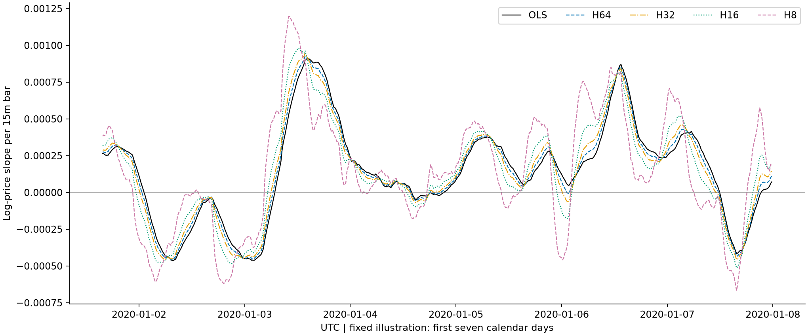
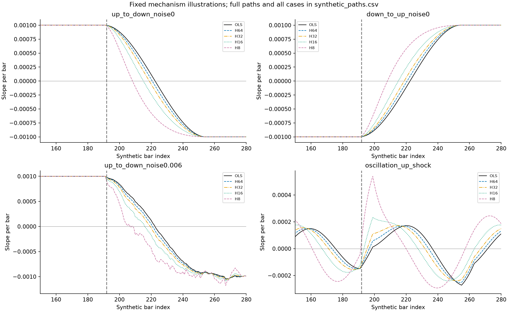
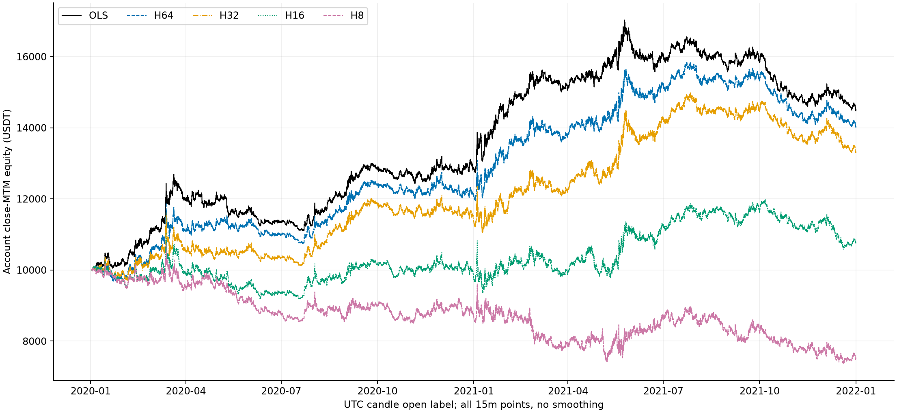
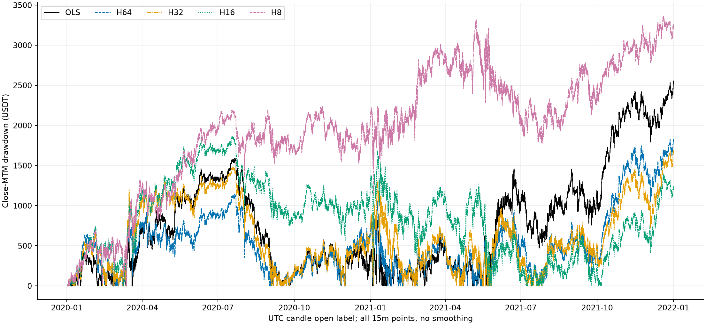
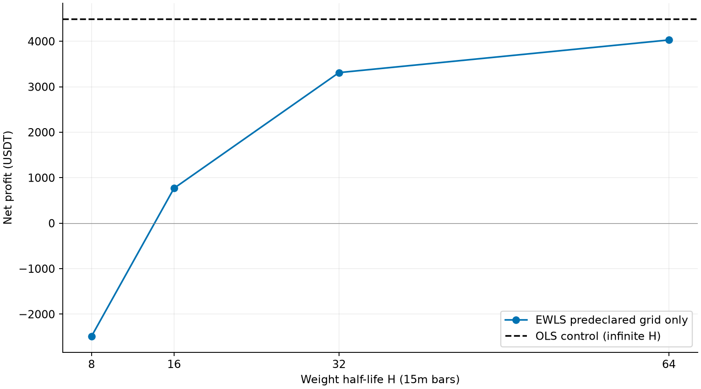
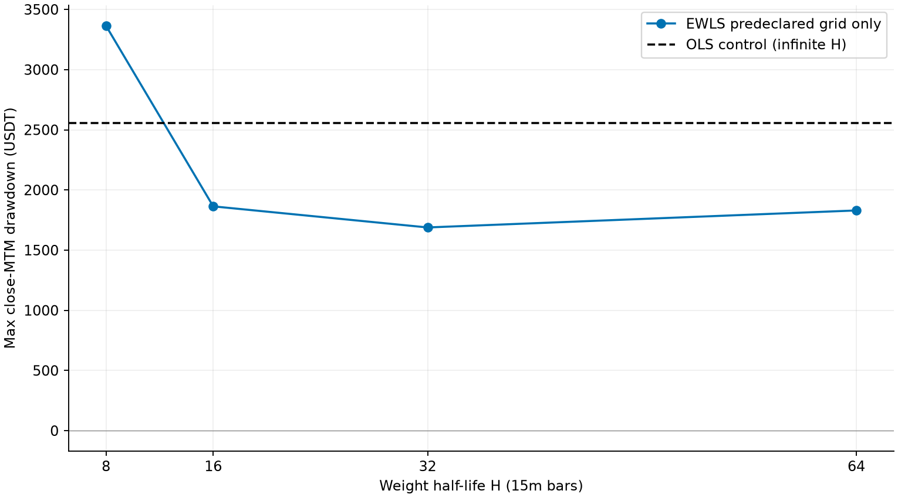
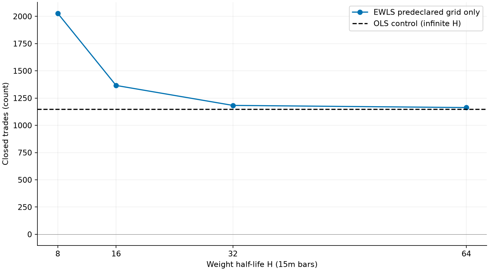
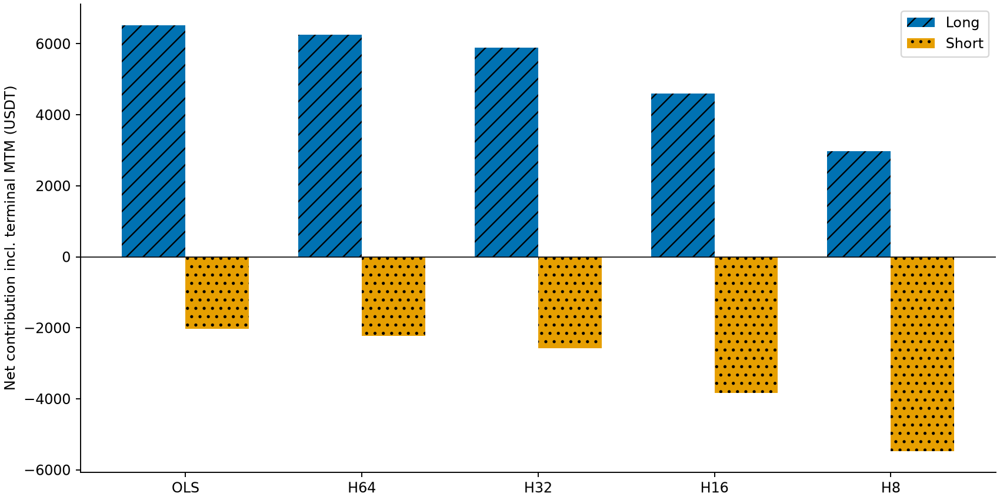
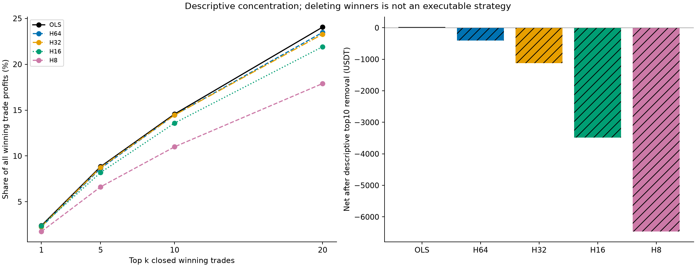

# S1.3 近期加权斜率：2020—2021固定五组研究

## 研究边界与公平性

基于S1.2提交 `c80864ef9f3a2fcccf39ba616b04f295779b98a6` 独立分支，全部原跟踪文件字节不变。原S0 OLS N64为对照；仅新增权重半衰期H，固定∞、64、32、16、8；不继承S1.2止损。未自动选择H，未扩大搜索，不计算2022/2023绩效，不读取2024+。
S0快照SHA256 `23972d31dd5ff90b46da05703e1b75dbfbbbbfde6efcd26b6b9ad24ee3b65503`；原loader只读六列OHLCV，对2020—2023快照做结构QC，计算前截取2020—2021。这四年历史已被旧研究使用，未来验证也不得称完全独立未见OOS。
所有候选固定64窗口/96根预热，首成交2020-01-02 00:00 UTC，初始10000、名义2000、保证金预算1000、杠杆2、不复利，单边费0.05%、滑点0.02%。直接调用原S0信号器、成交器、指标口径；不修改它们，不增加阈值/标准化/过滤/退出机制。
基准门禁：H=∞独立数学实现与OLS斜率及信号逐位相等；基准账本/成交事件在原CSV精度完全相等，资金/回撤与原文件误差分别5e-08/5e-09 USDT；多空、费用、指标独立通过1e-6对账。基准不一致将先于有限H计算停止。

## 数学与时序

窗口i=0..63，y=ln(close)，w=2^(-(63-i)/H)，x=i；加权均值后beta=sum(w*(x-xbar)*(y-ybar))/sum(w*(x-xbar)^2)。最新w=1，H根前权重折半；输出单位为每15分钟对数价格变化。用减去窗口首y的等价中心化提高浮点稳定性，无信号epsilon。H=∞用独立等权中心求和验证，实际基准使用原OLS函数。
严格beta正负做多空，精确零继承，非有限值不下单；bar收盘可用，下一bar开盘反手；最后bar信号不执行。年末不强制平仓，期末未平仓按最后close MTM，无虚构退出费。图表date为K线开盘标签，equity在该根收盘才可用。

## 五组整体表现（不按收益排序）

| model | net_profit | gross_before_cost | fees | slippage_usdt | max_drawdown_usdt | profit_factor | sharpe | sortino | win_rate | trade_count | average_holding_hours | monthly_profit_ratio | longest_underwater_days | max_consecutive_losses |
|---|---|---|---|---|---|---|---|---|---|---|---|---|---|---|
| OLS | 4487.470 | 7706.444 | 2299.267 | 919.707 | 2555.870 | 1.172 | 1.077 | 1.748 | 0.347 | 1147 | 15.271 | 0.625 | 220.969 | 11 |
| H64 | 4028.743 | 7292.482 | 2331.242 | 932.497 | 1829.726 | 1.151 | 0.966 | 1.583 | 0.341 | 1163 | 15.060 | 0.583 | 172.365 | 18 |
| H32 | 3311.004 | 6630.752 | 2371.248 | 948.500 | 1688.420 | 1.120 | 0.789 | 1.258 | 0.329 | 1183 | 14.805 | 0.625 | 175.229 | 15 |
| H16 | 767.863 | 4599.982 | 2737.228 | 1094.891 | 1863.676 | 1.025 | 0.183 | 0.285 | 0.306 | 1366 | 12.822 | 0.458 | 436.604 | 16 |
| H8 | -2487.528 | 3198.207 | 4061.239 | 1624.496 | 3363.908 | 0.935 | -0.610 | -0.891 | 0.270 | 2028 | 8.636 | 0.375 | 658.906 | 18 |

| model | long_net_profit | short_net_profit | winning_trade_count | losing_trade_count | margin_budget_shortfall_entries | min_actual_equity | funded_execution_feasible |
|---|---|---|---|---|---|---|---|
| OLS | 6515.405 | -2027.935 | 398 | 749 | 0 | 9998.600 | True |
| H64 | 6250.909 | -2222.166 | 397 | 766 | 0 | 9674.647 | True |
| H32 | 5893.913 | -2582.909 | 389 | 794 | 0 | 9701.578 | True |
| H16 | 4602.104 | -3834.241 | 418 | 948 | 0 | 9186.162 | True |
| H8 | 2979.436 | -5466.964 | 548 | 1480 | 0 | 7376.954 | True |

- H64：平仓1163笔（+16），总成本3263.74 USDT（+44.76）；2020/2021净收益2112.82/1915.92；原top10区间实际净收益3918.81，同向覆盖仓提前退出8/10，原入口无同向覆盖0/10；匹配反向提前/滞后/同期869/39/178，有符号延迟均值-1.40根。
- H32：平仓1183笔（+36），总成本3319.75 USDT（+100.77）；2020/2021净收益1368.85/1942.16；原top10区间实际净收益3834.43，同向覆盖仓提前退出8/10，原入口无同向覆盖0/10；匹配反向提前/滞后/同期932/39/73，有符号延迟均值-3.00根。
- H16：平仓1366笔（+219），总成本3832.12 USDT（+613.14）；2020/2021净收益-228.02/995.88；原top10区间实际净收益3478.85，同向覆盖仓提前退出9/10，原入口无同向覆盖0/10；匹配反向提前/滞后/同期906/58/47，有符号延迟均值-5.60根。
- H8：平仓2028笔（+881），总成本5685.74 USDT（+2466.76）；2020/2021净收益-1322.80/-1164.73；原top10区间实际净收益2217.46，同向覆盖仓提前退出10/10，原入口无同向覆盖0/10；匹配反向提前/滞后/同期827/106/28，有符号延迟均值-8.05根。

毛利润=gross_before_cost，指费用/滑点前净价格损益，非仅盈利交易之和；盈利/亏损交易毛和另见gross_closed_profits/losses。PF/胜率/平均持有时间按该期退出的已平仓交易；净收益含未平仓MTM。Sharpe使用日损益/固定初始10000，样本日标准差、sqrt365；Sortino使用全部日负部RMS。回撤含期初10000峰值，15分钟收盘MTM，非完整盘中极值。年度风险指标重置分析峰值和亏损连串，实盘仓位不重置，年初承接仓位损益来自曲线增量。月度表同理；年度/月度净收益及多空可加总，交易级退出归属与MTM年度损益不可混同。

## 实验A：确定性响应机制

固定seed=13032026，384根、真实反向bar192、潜在每根log增量±0.001；仅反向后加入固定共享高斯log价格观测噪声，sigma=0/.001/.003/.006，双方向。另有幅度.005、周期64的正弦震荡，在192..199施加±.012临时log价格偏移，非永久趋势变化。所有模型用相同路径；合成仅研究机制，不替代市场收益。

| case | model | first_new_direction_index | response_delay_bars | delay_change_vs_ols | wrong_destination_flips |
|---|---|---|---|---|---|
| up_to_down_noise0 | OLS | 223 | 31 | 0 | 0.000 |
| up_to_down_noise0 | H64 | 221 | 29 | -2 | 0.000 |
| up_to_down_noise0 | H32 | 219 | 27 | -4 | 0.000 |
| up_to_down_noise0 | H16 | 216 | 24 | -7 | 0.000 |
| up_to_down_noise0 | H8 | 209 | 17 | -14 | 0.000 |
| down_to_up_noise0 | OLS | 223 | 31 | 0 | 0.000 |
| down_to_up_noise0 | H64 | 221 | 29 | -2 | 0.000 |
| down_to_up_noise0 | H32 | 219 | 27 | -4 | 0.000 |
| down_to_up_noise0 | H16 | 216 | 24 | -7 | 0.000 |
| down_to_up_noise0 | H8 | 209 | 17 | -14 | 0.000 |

完整50行见synthetic_response_tests.csv；完整路径见synthetic_paths.csv。趋势错误反向=切换目的方向与当时潜在增量符号相反，反向后再次回错方向单列post_response_wrong_switchbacks；震荡冲击无唯一真趋势，additional_flips_vs_unshocked只是相对配对未冲击路径的增加次数，不擅称错误。图仅固定展示四个机制案例，CSV保留全部。

## 实验C：真实市场反向配对与交易变化

| model | signal_agreement_ratio | candidate_flip_count | early_reversals | late_reversals | same_reversals | signed_delay_mean_bars | signed_delay_median_bars | unmatched_ols_reversals | unmatched_candidate_reversals | exact_new_entry_identities | exact_missing_original_entries |
|---|---|---|---|---|---|---|---|---|---|---|---|
| OLS | 1.000 | 1147 | 0 | 0 | 1147 | 0.000 | 0 | 0 | 0 | 0 | 0 |
| H64 | 0.972 | 1163 | 869 | 39 | 178 | -1.401 | -1 | 61 | 77 | 985 | 969 |
| H32 | 0.945 | 1183 | 932 | 39 | 73 | -3.005 | -3 | 103 | 139 | 1110 | 1074 |
| H16 | 0.890 | 1366 | 906 | 58 | 47 | -5.595 | -6 | 136 | 355 | 1320 | 1101 |
| H8 | 0.783 | 2028 | 827 | 106 | 28 | -8.046 | -9 | 186 | 1067 | 2001 | 1120 |

真实行情没有可观测“真反转”，不能把比OLS早等同更正确。为避免无限制最近邻重复配对，以相邻OLS反向的时间中点划分不重叠Voronoi区间（中点归前区间），各区间匹配最近的同目的方向候选反向，等距取早，未匹配显式保留。负delta为提前、正为滞后。它是固定描述规则，不是因果地面真值；窗口内多次震荡也可造成未匹配事件。逐事件见signal_flip_comparison.csv；新增/取消反向仅按此约定；精确入口未匹配还包括时间移动，不等同取消交易。
使用索引95..70174的收盘信号，对应性能期下一开盘；不包含最后不可执行的收盘信号。每个非零翻转是一笔退出+新入场，因而增加交易会增加两边成本；初始入场和期末MTM单独保留。逐根斜率与信号见slope_signal_paths.csv。

## 实验D：收益结构与原始大赢家

| model | top10_original_net_pnl | top10_actual_interval_pnl | top10_interval_retention_ratio | top10_intervals_positive | top10_covering_early_exits | top10_no_same_direction_cover | top10_covering_smaller_positive | top10_interval_smaller_positive | top10_intervals_became_losses |
|---|---|---|---|---|---|---|---|---|---|
| OLS | 4468.004 | 4468.004 | 1.000 | 10 | 0 | 0 | 0 | 0 | 0 |
| H64 | 4468.004 | 3918.814 | 0.877 | 10 | 8 | 0 | 8 | 7 | 0 |
| H32 | 4468.004 | 3834.432 | 0.858 | 10 | 8 | 0 | 8 | 6 | 0 |
| H16 | 4468.004 | 3478.846 | 0.779 | 10 | 9 | 0 | 8 | 7 | 0 |
| H8 | 4468.004 | 2217.458 | 0.496 | 7 | 10 | 0 | 7 | 6 | 3 |

| model | top_profit_usdt | share_of_winning_profit | share_of_net_profit | net_without_top_winners |
|---|---|---|---|---|
| OLS | 4468.004 | 0.146 | 0.996 | 19.466 |
| H64 | 4436.374 | 0.145 | 1.101 | -407.631 |
| H32 | 4434.889 | 0.145 | 1.339 | -1123.885 |
| H16 | 4255.983 | 0.136 | 5.543 | -3488.120 |
| H8 | 3977.469 | 0.110 | nan | -6464.997 |

固定原OLS已平仓净收益最高10笔身份，不根据EWLS收益重选。trade_level_comparison.csv保留全部1147个原交易×5候选，original_top10_winner_audit.csv为固定子集。提前退出定义：在原入场开盘执行后存在同方向覆盖仓，该覆盖仓的首次退出早于原退出。若覆盖仓更早入场，其完整交易PnL与原交易不可等同比较；covering_trade_*列只用于描述，主归因用actual_interval_pnl。
区间归因：在原入口到原出口开盘之间，承接仓以原入口raw open MTM，实际区间新开仓计真实入场价及费，出口开盘已有仓平仓计真实退出价及费；入口开盘已平仓的前仓不计，出口开盘新仓不计，未退出仓按出口raw open MTM，无虚构退出费。跨期标记仓位的费用归属与完整曲线不同，因此候选区间和不声称等于全曲线损益；基准每个原区间则与原交易净收益逐项相等。区间内包括实际反手、再进入及多空分项，故是实际候选路径归因，不是替换某个退出的反事实收益。原赢家区间保留率可大于1或为负，不是“原交易存活率”。
profit_concentration.csv同时保留整体/各年及多空的前1/5/10/20，删除赢家后的数值仅为描述性统计，非可执行回测。若总净收益≤0，top/净收益比例留空，避免误导。

## 实验B/E：年度、多空与相邻H

| model | period | net_profit | long_net_profit | short_net_profit | max_drawdown_usdt | profit_factor | sharpe | sortino | trade_count | fees | slippage_usdt | longest_underwater_days | max_consecutive_losses | margin_budget_shortfall_entries |
|---|---|---|---|---|---|---|---|---|---|---|---|---|---|---|
| OLS | 2020 | 2864.129 | 3549.788 | -685.659 | 1593.434 | 1.266 | 1.522 | 2.737 | 587 | 1177.132 | 470.853 | 169.323 | 11 | 0 |
| OLS | 2021 | 1623.341 | 2965.617 | -1342.276 | 2555.870 | 1.107 | 0.716 | 1.094 | 560 | 1122.136 | 448.854 | 220.969 | 11 | 0 |
| H64 | 2020 | 2112.820 | 3160.226 | -1047.405 | 1144.298 | 1.186 | 1.102 | 1.874 | 601 | 1205.104 | 482.042 | 172.365 | 16 | 0 |
| H64 | 2021 | 1915.923 | 3090.684 | -1174.760 | 1829.726 | 1.125 | 0.855 | 1.367 | 562 | 1126.138 | 450.455 | 158.188 | 18 | 0 |
| H32 | 2020 | 1368.847 | 2793.002 | -1424.155 | 1482.140 | 1.118 | 0.701 | 1.133 | 607 | 1217.095 | 486.838 | 175.229 | 9 | 0 |
| H32 | 2021 | 1942.157 | 3100.911 | -1158.754 | 1688.420 | 1.122 | 0.868 | 1.371 | 576 | 1154.154 | 461.662 | 158.188 | 15 | 0 |
| H16 | 2020 | -228.017 | 2015.166 | -2243.182 | 1863.676 | 0.984 | -0.115 | -0.182 | 705 | 1413.134 | 565.254 | 293.906 | 16 | 0 |
| H16 | 2021 | 995.880 | 2586.938 | -1591.059 | 1463.317 | 1.057 | 0.450 | 0.694 | 661 | 1324.094 | 529.638 | 135.271 | 13 | 0 |
| H8 | 2020 | -1322.800 | 1450.738 | -2773.538 | 2235.506 | 0.922 | -0.684 | -1.029 | 1009 | 2021.117 | 808.447 | 293.906 | 18 | 0 |
| H8 | 2021 | -1164.728 | 1528.698 | -2693.426 | 2231.501 | 0.945 | -0.543 | -0.777 | 1019 | 2040.123 | 816.049 | 361.719 | 13 | 0 |

| H_left | H_right | left_net | right_net | net_gap_usdt | left_dd | right_dd | left_trades | right_trades | left_worst_year | right_worst_year |
|---|---|---|---|---|---|---|---|---|---|---|
| 8.000 | 16.000 | -2487.528 | 767.863 | 3255.391 | 3363.908 | 1863.676 | 2028.000 | 1366.000 | -1322.800 | -228.017 |
| 16.000 | 32.000 | 767.863 | 3311.004 | 2543.141 | 1863.676 | 1688.420 | 1366.000 | 1183.000 | -228.017 | 1368.847 |
| 32.000 | 64.000 | 3311.004 | 4028.743 | 717.740 | 1688.420 | 1829.726 | 1183.000 | 1163.000 | 1368.847 | 1915.923 |

只比较固定相邻H 8↔16↔32↔64，不给自动分数/胜出阈值；年度差异、多空差异、回撤和成本同时审阅。参数邻域描述见parameter_stability.csv，不把曲线平滑直接解释为独立稳健性证据。long_short_comparison.csv独立对账全部/各年每方向净收益、交易、费用、滑点、风险及收益集中度。

## 八个问题与数据支持的审阅意见

1. **EWLS是否真正缩短响应？** 在两个无噪声已知反转中，是。OLS延迟31根；H64/H32/H16/H8为29/27/24/17根。最高噪声上转下案例H8发生1次错误反向，其他候选在这些固定反转案例为0；不能把更快当成更正确，合成不代表真实市场。
2. **缩短多少根？** 无噪声分别少2/4/7/14根，即30/60/105/210分钟。真实反向配对有符号均值依次为-1.40/-3.00/-5.60/-8.05根；未匹配事件全部保留，非真实趋势检测延迟。
3. **交易是否增加？** 全部增加，从1147笔到1163/1183/1366/2028，分别增加16/36/219/881笔。H8额外交易最多，胜率从34.7%降至27.0%；没有证据说更多翻转提高了整体质量。
4. **成本是否增加？** 原总手续费+滑点3218.97 USDT，四个EWLS依次3263.74/3319.75/3832.12/5685.74。H8增加76.6%。收益退化不能只归因费用：整体多头贡献随H缩短由6515.40降至2979.44，空头负贡献由-2027.93扩大至-5466.96。
5. **是否保留原始大赢家？** H64/H32仍有10/10原赢家区间盈利，但8/10入口同向覆盖仓提前退出；整段实际净收益保留87.71%/85.82%。H16保留77.86%；H8仅49.63%，原10个区间有3个转负。提前退出数量不等于丢失全部趋势收益。各EWLS删除自身前10赢家后均为负，收益集中依赖没有解决。
6. **是否改善年度稳定性？** H64的2020/2021收益为2112.82/1915.92，年差196.90，较原2864.13/1623.34更平衡，最弱年也提高；H32为1368.85/1942.16，两年正但最弱年低于原。H16的2020负收益，H8两年负收益。这里只是两个开发年份的描述证据。
7. **是否连续近优？** H32—H64形成一个相邻的风险/收益权衡区域：两年均正，回撤1688.42/1829.73均低于原2555.87，最长水下175.23/172.36天低于原220.97，净收益差717.74。可称值得审阅的连续区域，不能声称已经证明“稳健近优”。向H16/H8继续缩短明显退化，不支持只追求最快响应。
8. **是否值得替代原OLS？** **现在不足以直接替代。** H64/H32的回撤分别下降28.4%/33.9%，但净收益损失10.2%/26.2%，PF和Sharpe均下降；最大连亏由11增至18/15。它们不是对OLS的全面改进，H16/H8更不支持采用。研究建议是先审阅H32—H64的风险折中、短持仓与空头拖累，不加新条件、不自动冻结任何H；原OLS继续作为基准。后续是否冻结及验证，交负责人决定。

- **H64**：无噪声延迟29根，比OLS少2根；真实匹配平均提前1.40根（非准确率）。平仓多16笔，总成本增加44.76 USDT；原top10区间保留87.71%，8/10覆盖仓提前退出；移除候选自身top10后的描述净收益-407.63 USDT。
- **H32**：无噪声延迟27根，比OLS少4根；真实匹配平均提前3.00根（非准确率）。平仓多36笔，总成本增加100.77 USDT；原top10区间保留85.82%，8/10覆盖仓提前退出；移除候选自身top10后的描述净收益-1123.89 USDT。
- **H16**：无噪声延迟24根，比OLS少7根；真实匹配平均提前5.60根（非准确率）。平仓多219笔，总成本增加613.14 USDT；原top10区间保留77.86%，9/10覆盖仓提前退出；移除候选自身top10后的描述净收益-3488.12 USDT。
- **H8**：无噪声延迟17根，比OLS少14根；真实匹配平均提前8.05根（非准确率）。平仓多881笔，总成本增加2466.76 USDT；原top10区间保留49.63%，10/10覆盖仓提前退出；移除候选自身top10后的描述净收益-6465.00 USDT。

以上是固定开发样本的探索性解释，不是选定参数或后续检验结论。没有开展阈值、确认根数、冷却或其他新搜索。

## 图表与原始数据浏览

交互式原始行情页面（额外展示交付，不改策略）：[market_explorer.html](market_explorer.html)，由`tools/build_s1_3_explorer.py`生成；包括逐根OHLCV、信号、成交、五组资金曲线及持仓时长描述统计。密集图的像素聚合会明确标注，悬浮始终读取原始单根。

## 限制、执行风险与复现

保证金不足记录而不阻断开仓，保持S0研究口径；funded_execution_feasible=false时后续收益是潜在资金不足下的假设路径，不能称可实盘融资执行。未建资金费率、交易所强平或借贷模型。OHLCV开盘成交仅假设，零量记录原样保留；zero_volume_execution_audit.csv逐项报告不确定性。期末开放仓单列open_positions.csv，未当已平仓计PF/胜率/集中度。
新实现没有调用旧Kalman、V18、止损执行器。新增程序重复运行每个估计器/模拟器并精确对账；前缀和未来扰动检查通过，分年分月及多空损益、账本、费、滑点和权益对账通过。旧文件和结果全部逐Git blob及SHA256核验。
复现（仓库根目录）：`$env:PYTHONPATH="$PWD/.deps"; $env:PYTEST_DISABLE_PLUGIN_AUTOLOAD='1'; python -m pytest -q`，然后 `python experiments/s1_3_recent_weighted_slope/run_experiment.py`，最后 `python tools/verify_s1_3_artifacts.py`。
diagnostic_metadata.json记录数据/配置/代码哈希、依赖、冻结基准；artifact_manifest.json覆盖本目录除自身外全部交付文件，不引入提交自哈希循环。run.log记录门禁及每组执行。完成后停止，不进入2022/2023，不选最佳H、不开展更细搜索。
