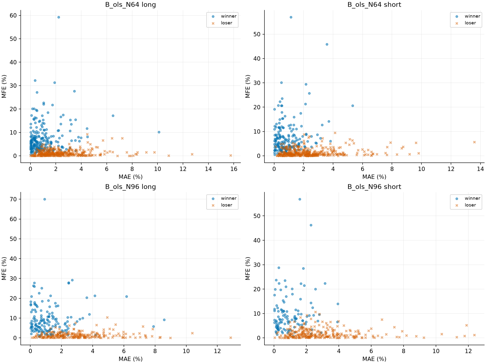
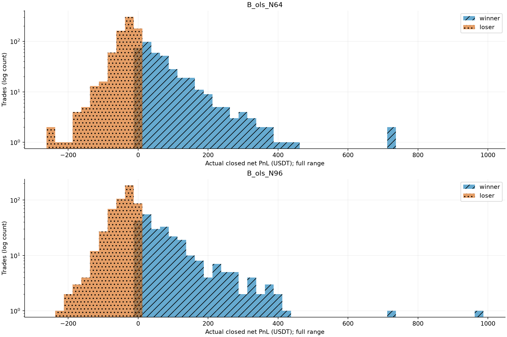
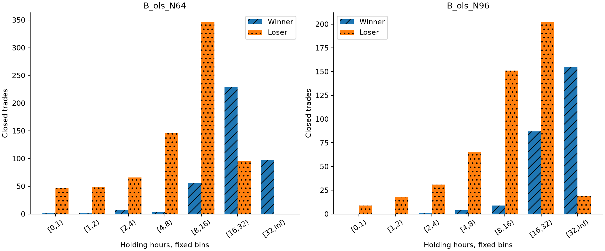
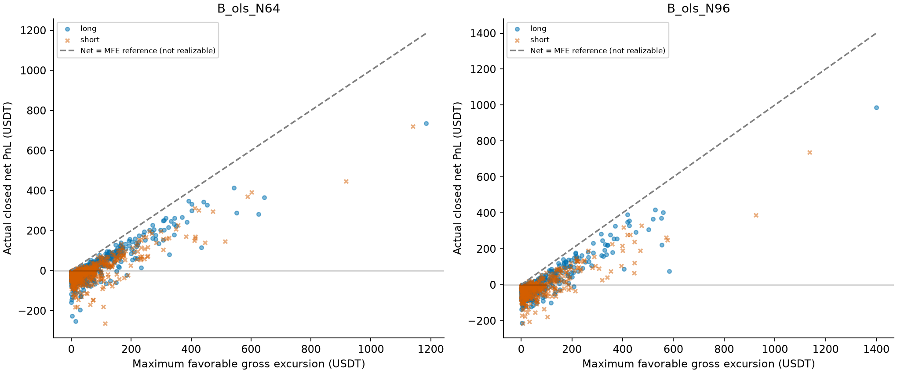
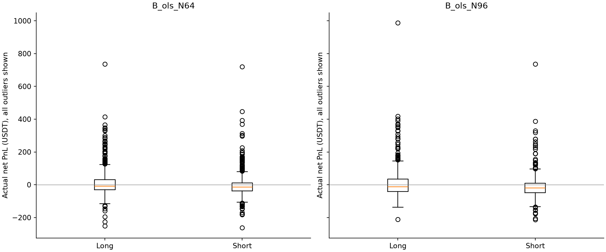
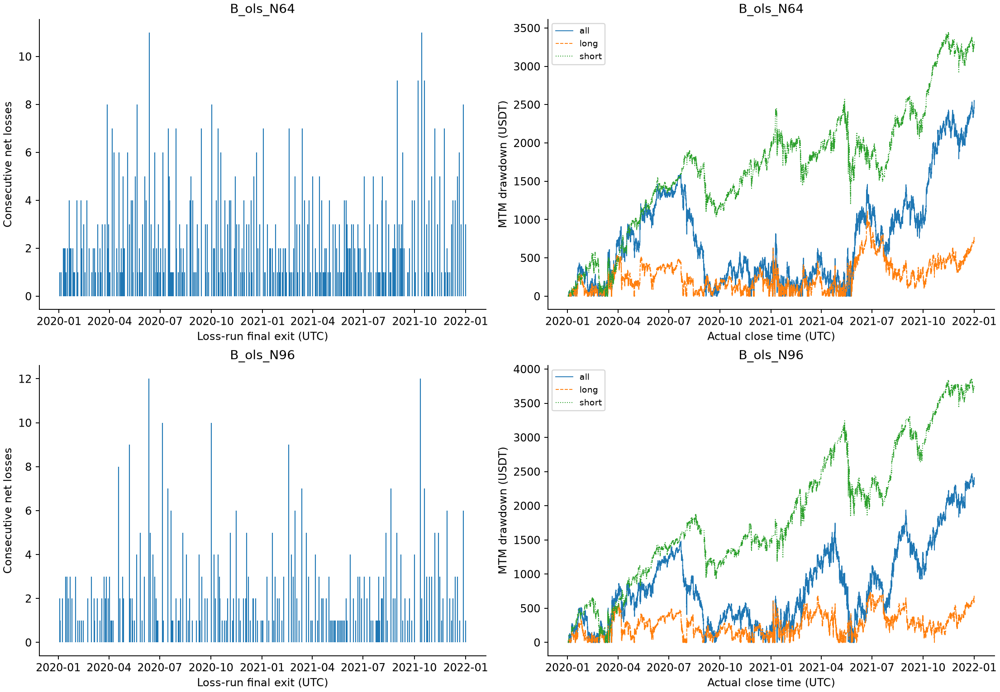

# S1.1 Trade Anatomy：2020—2021现有斜率交易行为

## 审计范围与口径

基准S0提交 `fd6658dbde9d046488577062dc53b84ef621c4bf`，只研究B_ols_N64（主）及B_ols_N96（辅）。不改变S0任何文件、公式、N、规则或结果；不调用估计器或执行器，不计算2022/2023指标、交易或绩效，未读取2024+。本轮只是历史探索性交易描述，四年历史已被研究使用过。
S0原产物清单、Git基准逐字节对照通过；两组交易数量、净收益、费用、滑点、每根权益及每根回撤对账通过，不需要重建交易。金额差异容差1e-6 USDT仅用于S0 CSV的小数序列化误差。
两个候选是研究对象，不是已冻结最终策略。记录中的零成交量假设成交（两组共2项）仍有执行不确定性。

### B_ols_N64

- 已平仓1147笔，盈利398、亏损749、持平0；已平仓净收益4501.90 USDT，末期未平仓MTM -14.43 USDT，合计4487.47 USDT。PF=1.172，平均盈利77.03、平均亏损-34.92、盈亏比2.206。
- 盈利平均/中位持仓26.29/23.25小时，亏损9.42/9.25小时；盈利平均MAE 0.998%、亏损2.454%，两类分布存在重叠，不能把均值当可用止损线。
- 719/749笔亏损交易曾有正的毛MFE，但正MFE不代表曾出现可扣费兑现的净利润。仅16笔是实际退出毛收益为正但扣双边手续费后转亏，故亏损不能只归因于手续费。
- 持仓≥32小时的已平仓亏损交易0笔，合计0.00 USDT；不等于这些仓位可通过时间退出避免。前10大赢家中最大MAE为3.579%，显示简单风险截断也可能伤及大赢家。
- 前10笔盈利合计4468.00 USDT，占所有盈利金额14.57%；从已平仓净收益扣除后33.89 USDT。加回未平仓MTM后19.47 USDT（与S0口径对齐）。
- 全部盈利交易价格回吐均值72.95 USDT、回吐比例中位数53.13%；前10大赢家价格回吐均值236.27 USDT、比例中位数35.60%。这些回吐不是可直接兑现的额外利润。
- 最大连亏11笔、最差连亏金额445.86 USDT；最差日-657.94（2021-01-08）、周-454.00（2021-10-04/2021-10-10）、月-1005.89（2021-10）。
- 最大收盘回撤2555.87 USDT；最长水下时长220.97天，最大深度那次回撤历时220.97天，是否已修复=False。9/24个月MTM亏损；最差3个亏损月占全部亏损月绝对损失58.97%。

### B_ols_N96

- 已平仓751笔，盈利256、亏损495、持平0；已平仓净收益3557.61 USDT，末期未平仓MTM -11.49 USDT，合计3546.12 USDT。PF=1.169，平均盈利96.06、平均亏损-42.49、盈亏比2.261。
- 盈利平均/中位持仓39.98/36.00小时，亏损14.71/15.00小时；盈利平均MAE 1.146%、亏损2.995%，两类分布存在重叠，不能把均值当可用止损线。
- 484/495笔亏损交易曾有正的毛MFE，但正MFE不代表曾出现可扣费兑现的净利润。仅13笔是实际退出毛收益为正但扣双边手续费后转亏，故亏损不能只归因于手续费。
- 持仓≥32小时的已平仓亏损交易19笔，合计-451.88 USDT；不等于这些仓位可通过时间退出避免。前10大赢家中最大MAE为6.163%，显示简单风险截断也可能伤及大赢家。
- 前10笔盈利合计4765.29 USDT，占所有盈利金额19.38%；从已平仓净收益扣除后-1207.67 USDT。加回未平仓MTM后-1219.16 USDT（与S0口径对齐）。
- 全部盈利交易价格回吐均值96.47 USDT、回吐比例中位数56.14%；前10大赢家价格回吐均值209.31 USDT、比例中位数28.42%。这些回吐不是可直接兑现的额外利润。
- 最大连亏12笔、最差连亏金额476.14 USDT；最差日-399.89（2021-01-08）、周-494.68（2021-08-02/2021-08-08）、月-1159.47（2021-08）。
- 最大收盘回撤2472.79 USDT；最长水下时长215.97天，最大深度那次回撤历时215.97天，是否已修复=False。12/24个月MTM亏损；最差3个亏损月占全部亏损月绝对损失49.65%。

## 1. MAE/MFE：从实际入场成交价出发

MAE与MFE以实际入场fill为分母；多头看最低/最高、空头看最高/最低，百分比乘100，USDT=比例×实际入场价×实际数量。路径含入场fill锚点，故MAE/MFE非负；费用不混入价格波动。
使用区间 **[入场K线,退出K线)** 内全部OHLC极值，并将退出原始open加入终点；退出K线其后的high/low/close完全不使用。另保留实际退出fill和退出滑点。入场bar的高低价可用，因为入场在其open；不假定同根high/low先后。
若MFE出现在MAE之前或之后，OHLC不能区分；本报告不推断“先扛亏再盈利”、盘中触发次序或一条连续盘中路径。
期末持仓只到训练末根close，单列open_positions.csv，不进入以下任何已平仓分布、连亏或方向交易统计；账户MTM风险则包含这部分浮动盈亏。

| candidate | direction | outcome | count | mean_mae_pct | median_mae_pct | mean_mfe_pct | p90_mae_pct | p90_mfe_pct |
|---|---|---|---|---|---|---|---|---|
| B_ols_N64 | long | loser | 354 | 2.515 | 2.026 | 1.228 | 4.690 | 2.828 |
| B_ols_N64 | short | winner | 178 | 0.945 | 0.684 | 7.724 | 2.101 | 15.323 |
| B_ols_N64 | long | winner | 220 | 1.041 | 0.682 | 7.535 | 2.460 | 15.468 |
| B_ols_N64 | short | loser | 395 | 2.399 | 2.028 | 1.410 | 4.522 | 3.591 |
| B_ols_N96 | long | loser | 229 | 3.069 | 2.777 | 1.474 | 5.761 | 3.058 |
| B_ols_N96 | short | loser | 266 | 2.932 | 2.319 | 1.873 | 5.216 | 4.487 |
| B_ols_N96 | long | winner | 147 | 1.237 | 0.918 | 9.515 | 2.435 | 18.657 |
| B_ols_N96 | short | winner | 109 | 1.023 | 0.792 | 10.061 | 2.272 | 20.296 |

亏损形成的两类可观测现象（毛MFE只说明有利极值，不说明可成交净浮盈）：

| candidate | direction | count | positive_mfe_count | gross_positive_net_loss_count | max_mae_pct |
|---|---|---|---|---|---|
| B_ols_N64 | long | 354 | 340 | 9 | 15.745 |
| B_ols_N64 | short | 395 | 379 | 7 | 13.586 |
| B_ols_N96 | long | 229 | 225 | 9 | 12.848 |
| B_ols_N96 | short | 266 | 259 | 4 | 12.369 |

完整分布及分位数见mae_mfe_analysis.csv；每笔路径索引、端点及USDT见trade_level_metrics.csv。

## 2. 持仓时间

盈利形成时间与亏损持仓时间的均值/中位数：

| candidate | direction | outcome | count | mean_hours | median_hours | net |
|---|---|---|---|---|---|---|
| B_ols_N64 | long | loser | 354 | 9.634 | 9.250 | -11984.197 |
| B_ols_N64 | short | winner | 178 | 23.910 | 21.875 | 12159.763 |
| B_ols_N64 | long | winner | 220 | 28.210 | 24.250 | 18499.601 |
| B_ols_N64 | short | loser | 395 | 9.222 | 9.000 | -14173.269 |
| B_ols_N96 | long | loser | 229 | 14.964 | 15.000 | -9385.982 |
| B_ols_N96 | short | loser | 266 | 14.498 | 15.125 | -11647.703 |
| B_ols_N96 | long | winner | 147 | 43.282 | 39.250 | 15381.434 |
| B_ols_N96 | short | winner | 109 | 35.521 | 34.000 | 9209.866 |

固定分组左闭右开，最后一组[32,∞)，不根据结果调边界。末期未平仓不进入分组。

| candidate | duration_bin | count | winners | losers | net_profit | mean_hours |
|---|---|---|---|---|---|---|
| B_ols_N64 | [0,1) | 49 | 2 | 47 | -826.651 | 0.500 |
| B_ols_N64 | [1,2) | 51 | 2 | 49 | -1545.698 | 1.328 |
| B_ols_N64 | [2,4) | 74 | 8 | 66 | -2209.411 | 2.801 |
| B_ols_N64 | [4,8) | 149 | 3 | 146 | -6756.979 | 5.829 |
| B_ols_N64 | [8,16) | 402 | 56 | 346 | -11441.304 | 11.873 |
| B_ols_N64 | [16,32) | 324 | 229 | 95 | 10276.900 | 22.146 |
| B_ols_N64 | [32,inf) | 98 | 98 | 0 | 17005.042 | 44.893 |
| B_ols_N96 | [0,1) | 9 | 0 | 9 | -97.431 | 0.389 |
| B_ols_N96 | [1,2) | 18 | 0 | 18 | -365.373 | 1.403 |
| B_ols_N96 | [2,4) | 32 | 1 | 31 | -1613.477 | 2.688 |
| B_ols_N96 | [4,8) | 69 | 4 | 65 | -3958.948 | 5.587 |
| B_ols_N96 | [8,16) | 160 | 9 | 151 | -7433.656 | 12.442 |
| B_ols_N96 | [16,32) | 289 | 87 | 202 | -3934.973 | 22.335 |
| B_ols_N96 | [32,inf) | 174 | 155 | 19 | 20961.472 | 49.263 |

盈利平均/中位持仓普遍长于亏损，收益需要捕获持续方向段，不能仅因持仓久就视为无效；[32,∞)中的亏损笔数及金额同时列出，说明长持仓亦可能失败。该关联是事后描述，不是时间止损效果。

## 3. 浮盈回吐（重点）

最大浮盈为MFE_USDT，未扣费用。主口径价格回吐=MFE_USDT−方向×数量×(退出原始open−实际入场fill)。执行口径回吐=MFE_USDT−账本gross_after_slippage=主回吐+退出滑点，不含手续费。
回吐比例以MFE为分母，MFE≤0留空。比例可超过100%（先有有利极值但终点转为毛亏损），不能截断。实际net另外扣双边手续费，不得拿MFE−net误称价格回吐。

| candidate | direction | outcome | count | mean_price_giveback | median_giveback_ratio |
|---|---|---|---|---|---|
| B_ols_N64 | long | loser | 354 | 56.040 | 2.536 |
| B_ols_N64 | short | winner | 178 | 83.826 | 0.613 |
| B_ols_N64 | long | winner | 220 | 64.154 | 0.466 |
| B_ols_N64 | short | loser | 395 | 61.666 | 2.335 |
| B_ols_N96 | long | loser | 229 | 68.093 | 2.401 |
| B_ols_N96 | short | loser | 266 | 78.825 | 2.440 |
| B_ols_N96 | long | winner | 147 | 83.184 | 0.500 |
| B_ols_N96 | short | winner | 109 | 114.383 | 0.614 |

profit_giveback_analysis.csv分别保存价格及执行口径、盈利/亏损/方向分布；top20_winner_paths.csv可逐笔核查大赢家回吐。
OHLC最高浮盈是假设价格极值，并不保证该时点存在足够流动性可退出。任何止盈/移动止损还会改变后续持仓与大赢家，不可将回吐金额直接视为可挽回利润。

## 4. 盈亏分布与收益集中度

| candidate | direction | trade_count | winning_count | losing_count | mean_win | mean_loss | median_win | median_loss | payoff_ratio | profit_factor | max_win | max_loss | closed_net_profit |
|---|---|---|---|---|---|---|---|---|---|---|---|---|---|
| B_ols_N64 | all | 1147 | 398 | 749 | 77.034 | -34.923 | 50.300 | -25.909 | 2.206 | 1.172 | 736.594 | -262.314 | 4501.899 |
| B_ols_N64 | long | 574 | 220 | 354 | 84.089 | -33.854 | 57.485 | -24.474 | 2.484 | 1.544 | 736.594 | -251.542 | 6515.405 |
| B_ols_N64 | short | 573 | 178 | 395 | 68.313 | -35.882 | 39.306 | -26.830 | 1.904 | 0.858 | 720.290 | -262.314 | -2013.506 |
| B_ols_N96 | all | 751 | 256 | 495 | 96.060 | -42.492 | 62.833 | -33.449 | 2.261 | 1.169 | 987.117 | -213.939 | 3557.614 |
| B_ols_N96 | long | 376 | 147 | 229 | 104.636 | -40.987 | 66.601 | -35.637 | 2.553 | 1.639 | 987.117 | -211.778 | 5995.452 |
| B_ols_N96 | short | 375 | 109 | 266 | 84.494 | -43.788 | 55.234 | -32.488 | 1.930 | 0.791 | 736.021 | -213.939 | -2437.838 |

| candidate | top_k | top_net_profit | share_winning_profit | share_closed_net | closed_net_without_top | top_mean_mae_usdt | top_mean_mfe_usdt | top_mean_price_giveback_usdt |
|---|---|---|---|---|---|---|---|---|
| B_ols_N64 | 1 | 736.594 | 0.024 | 0.164 | 3765.305 | 44.329 | 1185.070 | 445.558 |
| B_ols_N64 | 5 | 2709.058 | 0.088 | 0.602 | 1792.841 | 31.731 | 877.553 | 333.398 |
| B_ols_N64 | 10 | 4468.004 | 0.146 | 0.992 | 33.895 | 24.201 | 685.512 | 236.268 |
| B_ols_N64 | 20 | 7373.103 | 0.240 | 1.638 | -2871.204 | 23.642 | 561.399 | 190.284 |
| B_ols_N96 | 1 | 987.117 | 0.040 | 0.277 | 2570.497 | 18.360 | 1399.336 | 409.126 |
| B_ols_N96 | 5 | 2934.773 | 0.119 | 0.825 | 622.841 | 45.213 | 808.256 | 218.695 |
| B_ols_N96 | 10 | 4765.286 | 0.194 | 1.339 | -1207.672 | 40.997 | 688.419 | 209.313 |
| B_ols_N96 | 20 | 7790.566 | 0.317 | 2.190 | -4232.952 | 29.689 | 551.429 | 159.391 |

该表使用已平仓净收益，S0的全期总收益另外含末期未平仓MTM，因此去掉top10后的数值须加回该MTM才与S0的19.47/−1219.16口径一致。profit_concentration.csv有全部多空细分。
删除交易后的数字只是描述性扣除，不是可执行回测。正净收益对尾部趋势赢家有实质依赖；不宜以提高胜率为唯一退出目标。

## 5. 亏损聚集与风险

连亏按实际退出顺序，净收益≥0终止亏损序列；方向独立序列会忽略对侧交易，不能将方向连亏误称账户同时连续亏损。
本策略没有止损，因此亏损串是斜率翻向退出/反向的损失，不称“反复止损”。短时反向交易数量提供行为证据，未增加震荡或其他技术指标定义市场状态。

| candidate | direction | max_consecutive_losses | max_consecutive_loss_usdt | worst_day_pnl | worst_day_period | worst_week_pnl | worst_week_period | worst_month_pnl | worst_month_period | max_drawdown_usdt | max_drawdown_duration_days | flips_within_1h_count | losses_within_1h_count |
|---|---|---|---|---|---|---|---|---|---|---|---|---|---|
| B_ols_N64 | all | 11 | 445.864 | -657.940 | 2021-01-08 | -453.999 | 2021-10-04/2021-10-10 | -1005.887 | 2021-10 | 2555.870 | 220.969 | 49 | 47 |
| B_ols_N64 | long | 10 | 435.557 | -334.432 | 2021-01-08 | -255.423 | 2020-05-04/2020-05-10 | -419.033 | 2021-12 | 1109.265 | 220.969 | 22 | 21 |
| B_ols_N64 | short | 25 | 953.574 | -323.508 | 2021-01-08 | -339.261 | 2021-05-31/2021-06-06 | -884.956 | 2021-10 | 3441.339 | 658.906 | 27 | 26 |
| B_ols_N96 | all | 12 | 476.139 | -399.889 | 2021-01-08 | -494.684 | 2021-08-02/2021-08-08 | -1159.474 | 2021-08 | 2472.793 | 215.969 | 9 | 9 |
| B_ols_N96 | long | 9 | 489.807 | -245.826 | 2021-01-08 | -346.685 | 2021-06-21/2021-06-27 | -447.538 | 2021-06 | 733.202 | 140.042 | 3 | 3 |
| B_ols_N96 | short | 18 | 730.901 | -223.775 | 2020-04-16 | -418.728 | 2021-08-02/2021-08-08 | -901.148 | 2021-08 | 3857.797 | 655.542 | 6 | 6 |

完整亏损序列在loss_streaks.csv，序列长度频数在loss_streak_distribution.csv。日/周/月风险来自逐K线账户MTM（含末期持仓），不是只按平仓日汇总。周为UTC周一至周日；期间归属沿S0开盘标签。
回撤用实际收盘时刻计算水下时长，初始10000纳入峰值；最长时长与最大深度可能属于不同回撤，未修复时长为截至训练末端的下界。方向曲线是单独的贡献账本加10000，不能简单相加方向最大回撤。
亏损在表中列出的月份和连亏串内聚集，最差3个月损失比例提供定量描述；没有随机基准或独立重采样检验，不能据此宣布“统计上非随机”或确定某种市场状态导致损失。

## 6. 多空结构差异

| candidate | direction | trade_count | win_rate | mean_win | mean_loss | profit_factor | mean_mae_pct | mean_mfe_pct | mean_holding_hours | max_consecutive_losses | closed_net_profit |
|---|---|---|---|---|---|---|---|---|---|---|---|
| B_ols_N64 | long | 574 | 0.383 | 84.089 | -33.854 | 1.544 | 1.950 | 3.645 | 16.754 | 10 | 6515.405 |
| B_ols_N64 | short | 573 | 0.311 | 68.313 | -35.882 | 0.858 | 1.947 | 3.372 | 13.785 | 25 | -2013.506 |
| B_ols_N96 | long | 376 | 0.391 | 104.636 | -40.987 | 1.639 | 2.353 | 4.618 | 26.035 | 9 | 5995.452 |
| B_ols_N96 | short | 375 | 0.291 | 84.494 | -43.788 | 0.791 | 2.377 | 4.253 | 20.609 | 18 | -2437.838 |

表中净收益是已平仓净收益，末期未平仓的方向与MTM独立列出：

| candidate | direction | entry_time | holding_hours | net_pnl | mae_pct | mfe_pct | status |
|---|---|---|---|---|---|---|---|
| B_ols_N64 | short | 2021-12-31 19:30:00+00:00 | 4.500 | -14.429 | 1.682 | 0.850 | open_marked_at_training_end |
| B_ols_N96 | short | 2021-12-31 21:30:00+00:00 | 2.500 | -11.491 | 1.533 | 0.000 | open_marked_at_training_end |

多头在这段历史呈现正向趋势捕获证据，空头在两种N下均拖累组合；这支持“历史方向不对称”的描述，不证明多头具有稳定因果优势或空头在其他阶段也必然失效。
现有证据不足以证明多空必须使用不同退出机制，也不足以新增多空独立参数。方向分离只能作为后续机制假设与报告维度；本轮不关闭任何方向。

## 三个核心问题与研究建议

**利润来自哪里？** 主要来自较长持仓、多头方向的大趋势赢家；较低胜率由较高盈亏比和少数尾部收益补偿。top1/5/10/20、时间分组及多空PF表给出量化证据。N96的年度退化不能被累计盈利掩盖。

**最大风险是什么？** 大赢家依赖与空头负贡献并存，反向亏损串和长时间水下会侵蚀耐受度；大幅MFE之后仍可能回吐。实际MAE/MFE路径无盘中先后，不能用最高浮盈构造可实现的止盈利润。资金费、强平、盘口及成交假设仍不完整。

**若下一步只能增加一个风险/退出参数，最支持研究什么？** 建议研究一个**多空共用、按入场成交价定义的固定最大亏损比例**，作为S1.2的独立公平对照假设；理由是已量化的亏损MAE、连亏和尾部回撤需要风险约束，而盈利更长持仓且依赖少数大赢家，过早固定止盈/时间退出可能损伤收益来源。该建议只确定研究方向，不指定、估计或测试任何止损阈值，也不声称止损一定改善结果。
盈利与亏损MAE分布有重叠，大赢家也承受不利波动与浮盈回吐；不能用亏损MAE的均值/分位数直接宣布止损线。下一阶段若获授权，应先冻结单一对照设计、成本及盘中成交处理，再评价风险约束与大赢家损伤，不能回看2022/2023挑阈值。多空独立退出、移动止盈均只是未验证假设，本轮不开展。

## 质量控制与交付

所有聚合均能追溯trade_id和CSV；独立重复分析逐表精确一致。MAE/MFE公式、方向、退出bar排除、未来扰动、末期持仓、连亏边界和回撤时长有单元测试；全部S0测试继续通过。
数据、原S0配置/产物及本轮配置/源码SHA256见diagnostic_metadata.json与artifact_manifest.json。S0原始输出保持字节不变。完整图表如下；散点包含全部已平仓交易，直方图全范围无截尾，回撤为完整15分钟序列。

本轮完成即停止，等待负责人审阅，不进入止损优化或S1.2。
